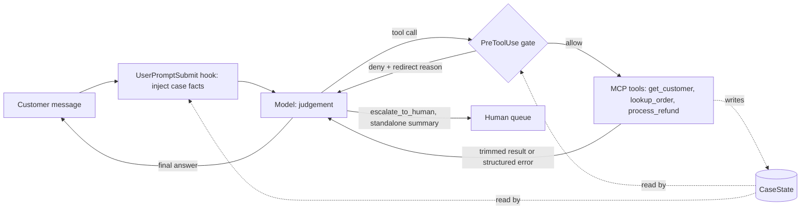

# Scenario 1: Customer Support Resolution Agent

## Description

You are building a customer support resolution agent using the Claude Agent SDK. The agent handles high-ambiguity requests like returns, billing disputes, and account issues. It has access to your backend systems through custom Model Context Protocol (MCP) tools (`get_customer`, `lookup_order`, `process_refund`, `escalate_to_human`). Your target is 80%+ first-contact resolution while knowing when to escalate.

## Primary domains

- [Domain 1: Agentic Architecture & Orchestration](../../domains/01-agentic-architecture-orchestration/README.md)
- [Domain 2: Tool Design & MCP Integration](../../domains/02-tool-design-mcp-integration/README.md)
- [Domain 5: Context Management & Reliability](../../domains/05-context-management-reliability/README.md)

## Sample questions

### Question 1

Production data shows that in 12% of cases, your agent skips `get_customer` entirely and calls `lookup_order` using only the customer's stated name, occasionally leading to misidentified accounts and incorrect refunds. What change would most effectively address this reliability issue?

- A. Add a programmatic prerequisite that blocks `lookup_order` and `process_refund` calls until `get_customer` has returned a verified customer ID.
- B. Enhance the system prompt to state that customer verification via `get_customer` is mandatory before any order operations.
- C. Add few-shot examples showing the agent always calling `get_customer` first, even when customers volunteer order details.
- D. Implement a routing classifier that analyzes each request and enables only the subset of tools appropriate for that request type.

**Correct: A.** When a specific tool sequence is required for critical business logic (like verifying customer identity before processing refunds), programmatic enforcement provides deterministic guarantees that prompt-based approaches cannot. B and C rely on probabilistic LLM compliance, which is insufficient when errors have financial consequences. D addresses tool availability rather than tool ordering, which is not the actual problem.

Related: [1.4](../../domains/01-agentic-architecture-orchestration/1.4-workflow-enforcement-handoff.md), [1.5](../../domains/01-agentic-architecture-orchestration/1.5-hooks-interception-normalization.md)

### Question 2

Production logs show the agent frequently calls `get_customer` when users ask about orders (e.g., "check my order #12345"), instead of calling `lookup_order`. Both tools have minimal descriptions ("Retrieves customer information" / "Retrieves order details") and accept similar identifier formats. What's the most effective first step to improve tool selection reliability?

- A. Add few-shot examples to the system prompt demonstrating correct tool selection patterns, with 5-8 examples showing order-related queries routing to `lookup_order`.
- B. Expand each tool's description to include input formats it handles, example queries, edge cases, and boundaries explaining when to use it versus similar tools.
- C. Implement a routing layer that parses user input before each turn and pre-selects the appropriate tool based on detected keywords and identifier patterns.
- D. Consolidate both tools into a single `lookup_entity` tool that accepts any identifier and internally determines which backend to query.

**Correct: B.** Tool descriptions are the primary mechanism LLMs use for tool selection. When descriptions are minimal, models lack the context to differentiate between similar tools. B addresses this root cause with a low-effort, high-leverage fix. Few-shot examples (A) add token overhead without fixing the underlying issue. A routing layer (C) is over-engineered and bypasses the LLM's natural language understanding. Consolidating tools (D) is a valid architectural choice but requires more effort than a "first step" warrants.

Related: [2.1](../../domains/02-tool-design-mcp-integration/2.1-tool-interface-design.md)

### Question 3

Your agent achieves 55% first-contact resolution, well below the 80% target. Logs show it escalates straightforward cases (standard damage replacements with photo evidence) while attempting to autonomously handle complex situations requiring policy exceptions. What's the most effective way to improve escalation calibration?

- A. Add explicit escalation criteria to your system prompt with few-shot examples demonstrating when to escalate versus resolve autonomously.
- B. Have the agent self-report a confidence score (1-10) before each response and automatically route requests to humans when confidence falls below a threshold.
- C. Deploy a separate classifier model trained on historical tickets to predict which requests need escalation before the main agent begins processing.
- D. Implement sentiment analysis to detect customer frustration levels and automatically escalate when negative sentiment exceeds a threshold.

**Correct: A.** Explicit escalation criteria with few-shot examples directly address the root cause: unclear decision boundaries. This is the proportionate first response before adding infrastructure. B fails because LLM self-reported confidence is poorly calibrated; the agent is already incorrectly confident on hard cases. C is over-engineered, requiring labeled data and ML infrastructure when prompt optimization hasn't been tried. D solves a different problem; sentiment doesn't correlate with case complexity.

Related: [5.2](../../domains/05-context-management-reliability/5.2-escalation-ambiguity.md), [4.2](../../domains/04-prompt-engineering-structured-output/4.2-few-shot-prompting.md)

## Code snippets

One runnable file wiring together the domain snippets: [1.1](../../domains/01-agentic-architecture-orchestration/1.1-agentic-loops.md), [1.4](../../domains/01-agentic-architecture-orchestration/1.4-workflow-enforcement-handoff.md), [1.5](../../domains/01-agentic-architecture-orchestration/1.5-hooks-interception-normalization.md), [2.1](../../domains/02-tool-design-mcp-integration/2.1-tool-interface-design.md), [2.2](../../domains/02-tool-design-mcp-integration/2.2-structured-error-responses.md), [5.1](../../domains/05-context-management-reliability/5.1-context-preservation.md) and [5.2](../../domains/05-context-management-reliability/5.2-escalation-ambiguity.md). The backend is faked so the file runs on its own.

### `support_agent.py`

```python
import asyncio
import json
from dataclasses import dataclass, field
from datetime import datetime, timezone
from typing import Any

from claude_agent_sdk import (
    AssistantMessage, ClaudeAgentOptions, ClaudeSDKClient, HookMatcher,
    ResultMessage, TextBlock, create_sdk_mcp_server, tool,
)

REFUND_LIMIT_USD = 500
RETURN_WINDOW_DAYS = 30


# ---------- per-conversation state (one instance per conversation in production) ----------
@dataclass
class CaseState:
    verified_customer_id: str | None = None
    issues: list[dict] = field(default_factory=list)

    def facts(self) -> str:
        lines = [f"customer_id: {self.verified_customer_id}"]
        for i in self.issues:
            lines.append(f"- order {i['order_id']} | ${i['total']:.2f} | status {i['status']} | {i.get('note', '')}")
        return "<case_facts>\n" + "\n".join(lines) + "\n</case_facts>"


state = CaseState()   # the hook gate and the injected facts read this same object, so enforcement and context cannot drift apart

# ---------- fake backend ----------
CUSTOMERS = [{"id": "cus_123", "email": "jane@example.com", "name": "Jane Doe"}]
ORDERS = {
    "12345": {"order_id": "12345", "customer_id": "cus_123", "status": 2, "total": 84.50,
              "items": ["blender"], "delivered_at": 1741046400, "days_since_delivery": 12,
              "warehouse_id": "W9", "carrier_code": "UPS", "tax_breakdown": {}, "audit_log": []},   # 40+ fields in reality
    "88888": {"order_id": "88888", "customer_id": "cus_123", "status": 2, "total": 899.00,
              "items": ["laptop"], "delivered_at": 1741046400, "days_since_delivery": 12},
}
STATUS_NAMES = {0: "pending", 1: "shipped", 2: "delivered", 3: "returned"}


def ok(payload: dict) -> dict[str, Any]:
    return {"content": [{"type": "text", "text": json.dumps(payload)}]}


def tool_error(category: str, message: str, retryable: bool, **extra) -> dict[str, Any]:
    payload = {"errorCategory": category, "isRetryable": retryable, "message": message, **extra}
    return {"content": [{"type": "text", "text": json.dumps(payload)}], "is_error": True}


# ---------- tools: detailed, non-overlapping descriptions ----------
@tool(
    "get_customer",
    "Look up a customer account by email address or phone number. Returns the verified customer ID. "
    "Use this FIRST to identify who you are talking to. It does not accept order numbers and returns no "
    "order data. If several accounts match, it returns all of them: ask the customer for another "
    "identifier instead of choosing one.",
    {"type": "object", "properties": {
        "email": {"type": "string", "description": "e.g. jane@example.com"},
        "phone": {"type": "string", "description": "E.164, e.g. +14155550123"}}},
)
async def get_customer(args):
    if not args.get("email") and not args.get("phone"):
        return tool_error("validation", "Provide an email or a phone number.", False)
    matches = [c for c in CUSTOMERS if c["email"] == (args.get("email") or "").lower()]
    if not matches:
        return ok({"found": False, "matches": []})        # valid empty result, not an error
    if len(matches) > 1:
        return ok({"found": True, "matches": [{"id": c["id"], "name": c["name"]} for c in matches],
                   "note": "Multiple matches. Ask for another identifier; do not pick one."})
    state.verified_customer_id = matches[0]["id"]
    return ok({"found": True, "customer_id": matches[0]["id"], "name": matches[0]["name"]})


@tool(
    "lookup_order",
    "Fetch one order's status, items, total and delivery date by order number (e.g. 12345 or #12345). "
    "Requires the customer_id returned by get_customer. Returns nothing about the customer's account or "
    "other orders.",
    {"type": "object", "properties": {
        "order_number": {"type": "string", "description": "digits only, no #"},
        "customer_id": {"type": "string", "description": "from get_customer"}},
     "required": ["order_number", "customer_id"]},
)
async def lookup_order(args):
    order = ORDERS.get(args["order_number"].lstrip("#"))
    if order is None:
        return ok({"found": False})
    if order["customer_id"] != args["customer_id"]:   # ownership is checked server-side; the model's customer_id is never trusted
        return tool_error("permission", "That order belongs to a different customer.", False)
    trimmed = {                                            # 5.1: keep only return-relevant fields
        "order_id": order["order_id"], "status": STATUS_NAMES[order["status"]],   # 1.5: numeric code -> name
        "items": order["items"], "total": order["total"],
        "delivered_at": datetime.fromtimestamp(order["delivered_at"], tz=timezone.utc).isoformat(),
        "days_since_delivery": order["days_since_delivery"],
    }
    state.issues.append({"order_id": trimmed["order_id"], "total": trimmed["total"], "status": trimmed["status"]})
    return ok(trimmed)


@tool(
    "process_refund",
    "Refund an order in full or in part. Only for orders inside the 30-day return window and only after "
    "the customer is verified. Amounts above $500 are not allowed here: use escalate_to_human.",
    {"type": "object", "properties": {"order_id": {"type": "string"}, "amount": {"type": "number"}},
     "required": ["order_id", "amount"]},
)
async def process_refund(args):
    order = ORDERS.get(args["order_id"])
    if order is None:
        return tool_error("validation", "Unknown order.", False)
    if args["amount"] > order["total"]:
        return tool_error("validation", "Refund exceeds the order total.", False)
    if order["days_since_delivery"] > RETURN_WINDOW_DAYS:   # needs order data, so it lives in the tool; identity and limit gates live in the hook
        return tool_error("business", "Outside the return window.", False,
                          customerExplanation="This order is past our 30-day return window, so I can't refund it directly.")
    for i in state.issues:
        if i["order_id"] == args["order_id"]:
            i["note"] = f"refunded ${args['amount']:.2f}"
    return ok({"refund_id": "re_001", "amount": args["amount"]})


@tool(
    "escalate_to_human",
    "Hand the case to a human agent. The human cannot see this conversation, so the summary must stand alone. "
    "Use for: explicit requests for a human, policy gaps, refunds above the limit, or no progress possible.",
    {"type": "object", "properties": {
        "customer_id": {"type": "string"},
        "issue_summary": {"type": "string"},
        "root_cause": {"type": "string"},
        "amount_requested": {"type": "number"},
        "actions_taken": {"type": "array", "items": {"type": "string"}},
        "recommended_action": {"type": "string"},
        "escalation_reason": {"type": "string", "enum": ["customer_request", "policy_gap", "over_limit", "no_progress"]}},
     "required": ["issue_summary", "recommended_action", "escalation_reason"]},
)
async def escalate_to_human(args):
    return ok({"ticket": "T-1001", "handoff": args})


# ---------- hooks: deterministic enforcement ----------
def deny(reason: str) -> dict:
    return {"hookSpecificOutput": {"hookEventName": "PreToolUse", "permissionDecision": "deny",
                                   "permissionDecisionReason": reason}}


async def enforce_policy(input_data, tool_use_id, context):
    name = input_data["tool_name"].rsplit("__", 1)[-1]
    args = input_data["tool_input"]
    if not state.verified_customer_id:
        return deny("Call get_customer and obtain a verified customer ID first.")           # 1.4 prerequisite gate
    if name == "process_refund" and args.get("amount", 0) > REFUND_LIMIT_USD:
        return deny(f"Refunds over ${REFUND_LIMIT_USD} need human approval. Call escalate_to_human with a full summary.")
    return {}


async def inject_case_facts(input_data, tool_use_id, context):
    return {"hookSpecificOutput": {"hookEventName": "UserPromptSubmit", "additionalContext": state.facts()}}


SYSTEM_PROMPT = """You are a customer support agent for returns, billing disputes and account issues.

Workflow: identify the customer with get_customer, then investigate each concern with lookup_order, then resolve.
Handle multi-part requests by treating each concern separately and giving one combined answer.

ESCALATE (escalate_to_human) when:
1. The customer explicitly asks for a human. Do it immediately, without investigating first.
2. Policy is silent or ambiguous about the request (e.g. a competitor price match).
3. You cannot make progress with the tools available.
RESOLVE YOURSELF when the issue is within policy, even if the customer is upset: acknowledge the frustration,
offer the fix, and escalate only if they repeat that they want a person.

<example>Customer: "Get me a human." -> escalate_to_human now. No lookups.</example>
<example>Customer: "Ridiculous, it arrived cracked again!" (photo, in-policy damage) -> apologise, process the refund or replacement. No escalation.</example>
<example>Customer: "Another store sells this for $20 less, match it?" -> policy only covers our own price changes: escalate (policy_gap).</example>
<example>Customer: "Refund order 12345" (delivered 12 days ago, damaged) -> standard case: verify, look up, refund.</example>

If get_customer returns several matches, ask for another identifier. Never guess.
If a tool returns a business error, explain it using customerExplanation. Do not retry non-retryable errors."""

server = create_sdk_mcp_server(name="support", tools=[get_customer, lookup_order, process_refund, escalate_to_human])

options = ClaudeAgentOptions(
    system_prompt=SYSTEM_PROMPT,
    mcp_servers={"support": server},
    tools=[],                                   # no built-ins: the agent only has the four support tools
    allowed_tools=["mcp__support__*"],
    hooks={
        # matcher omits get_customer (it would deadlock the gate) and escalate_to_human (the escape hatch must always stay open)
        "PreToolUse": [HookMatcher(matcher="mcp__support__lookup_order|mcp__support__process_refund", hooks=[enforce_policy])],
        "UserPromptSubmit": [HookMatcher(hooks=[inject_case_facts])],
    },
    max_turns=20,                               # cost backstop only; the loop still ends on the model's own stop signal
)


async def chat(user_messages: list[str]) -> None:
    async with ClaudeSDKClient(options=options) as client:     # one session across turns
        for text in user_messages:
            print(f"\nCustomer: {text}")
            await client.query(text)
            async for message in client.receive_response():
                if isinstance(message, AssistantMessage):
                    for block in message.content:
                        if isinstance(block, TextBlock):
                            print(f"Agent: {block.text}")
                elif isinstance(message, ResultMessage) and message.is_error:
                    print(f"[ended: {message.subtype}]")


if __name__ == "__main__":
    asyncio.run(chat([
        "Hi, I'm jane@example.com. Order #12345 arrived damaged and I want a refund. "
        "Also, I think I was charged twice on order 88888 for $899.",
    ]))
```

### Test the guarantees without calling the model

```python
async def test_gate_and_threshold():
    state.verified_customer_id = None
    call = {"tool_name": "mcp__support__process_refund", "tool_input": {"order_id": "12345", "amount": 20}}
    out = await enforce_policy(call, None, None)
    assert out["hookSpecificOutput"]["permissionDecision"] == "deny"          # blocked: not verified

    state.verified_customer_id = "cus_123"
    call["tool_input"]["amount"] = 900
    out = await enforce_policy(call, None, None)
    assert "escalate_to_human" in out["hookSpecificOutput"]["permissionDecisionReason"]   # over the limit
    call["tool_input"]["amount"] = 20
    assert await enforce_policy(call, None, None) == {}                         # allowed
```

### Where each exam question lives

| Sample question | Where in the code |
| - | - |
| Q1: skipping `get_customer` | `enforce_policy` blocks `lookup_order` / `process_refund` programmatically |
| Q2: `get_customer` vs `lookup_order` confusion | the tool descriptions say what each accepts and returns, and when not to use it |
| Q3: escalation calibration | explicit criteria plus few-shot examples in `SYSTEM_PROMPT`; no sentiment or confidence scores |

The `UserPromptSubmit` hook re-injects the case facts every turn, so amounts and order numbers do not get summarised away.

## Commentary: the architecture behind the code

SDK, CLI and config names are illustrative; the exam tests the reasoning, not the exact parameter.

### How the pieces fit together

The system splits work along one line: the model supplies judgement (which concern is this, which tool, when to escalate, how to phrase the answer) and code supplies guarantees (who has been verified, what may be refunded, what the model gets to see). Hooks sit at the two boundaries of the model: `UserPromptSubmit` shapes what enters its context, `PreToolUse` vetoes what leaves it as an action. The tools are the only route to the backend, and they return structured results so the next model decision is informed rather than guessed. The human queue is itself a tool, so escalation is an ordinary, always-available action rather than a failure mode.



The dotted lines are the point: tools write verified facts into `CaseState`, and the gate and the context injection read from it. The model never writes to that state directly, so a hallucinated customer ID cannot become "verified".

### Extended walk-through

Request: "Hi, I'm jane@example.com. Order #12345 arrived damaged and I want a refund. Also, I think I was charged twice on order 88888 for $899."

1. `UserPromptSubmit` injects `<case_facts>` with no customer ID yet. Deterministic; costs no model reasoning.
2. The model splits the message into two concerns and picks `get_customer` because the description says to use it first and that it takes an email. This is judgement; the description does the steering (Q2).
3. `get_customer` returns one match and records `verified_customer_id`. The matcher does not cover this tool, so the gate cannot block the step that unlocks it.
4. The model calls `lookup_order` for 12345. The gate passes (customer verified). The tool checks ownership server-side, then returns a trimmed record with a readable status. Only fields relevant to a return enter context.
5. `process_refund` for $84.50: under the limit, inside the window, success. The case facts now record the refund.
6. The model looks up 88888 ($899) and wants to refund it. The gate denies: over $500. The reason text tells the model to call `escalate_to_human` with a full summary. The model complies and includes the customer ID, the amount, the root cause and the refund already issued, because the human cannot see the transcript.
7. One combined reply covers both concerns: refund done, second case handed over.

Failure paths:

- **Skipped identification.** The model calls `lookup_order` using only a name. The gate denies with "call `get_customer` first"; the model corrects course. A prompt rule alone left this skipped in 12% of cases (Q1); the gate removes the path entirely.
- **Business rule violated.** An order 45 days old returns a non-retryable `business` error with a `customerExplanation`. The model explains the policy instead of retrying, and the category tells it that retrying is pointless.
- **Ambiguous identity.** Two accounts match the email. The tool returns both and a note; the model asks the customer for another identifier instead of picking one.
- **Customer asks for a human.** Escalation happens immediately with no investigation, as the first prompt criterion says. Frustration alone, with an in-policy problem, is not a trigger.
- **Later turns of a long chat.** Facts are re-injected, so amounts and order numbers survive even if earlier tool output has been summarised.

### Design decisions and trade-offs

- **Prerequisite gate in a hook, not in the prompt.** Identity verification precedes financial action, so the cost of a skipped step is a wrong refund. A prompt rule or few-shot examples are probabilistic. The prompt still states the workflow so the model plans correctly; the hook only guarantees it. A prompt alone wins only when a failure is cheap and recoverable.
- **Fix selection with descriptions before adding machinery.** Tool descriptions are the main signal for tool choice; stating inputs, outputs and boundaries addresses the root cause cheaply. A keyword routing layer bypasses the model's language understanding and breaks on phrasing it did not anticipate. Merging into one `lookup_entity` tool is legitimate but is a larger refactor than a first step.
- **Escalation by criteria and examples, not scores.** The agent is already wrongly confident on hard cases, so self-reported confidence is poorly calibrated. Sentiment tracks mood rather than case complexity. A trained classifier needs labelled data and infrastructure before anyone has tried clearer instructions. A classifier would win once prompt tuning plateaus and volume justifies it.
- **Policy split by what the rule needs.** Cross-cutting limits (verified identity, $500 ceiling) live in the hook, where they are centralised and testable without a model call. Rules that need backend data (return window, order ownership, refund not above total) live in the tool, where that data is already loaded. Putting everything in hooks would force the hook to fetch data; putting everything in tools scatters policy.
- **Structured errors over generic failures.** Category, retryability and a customer-safe explanation let the model choose between retrying, rephrasing, asking or escalating. A generic "operation failed" forces blind retries. An empty search result is returned as a normal result, not an error, because "no match" is a valid answer.
- **Case facts re-injected rather than trusted to history.** Long conversations compress older content, and exact amounts and IDs are what get lost. A small, deterministic summary block costs few tokens. The alternative, a larger window or relying on the transcript, does not stop summarisation from blurring specifics. In production the state must be per conversation: a shared global would let one customer's verification unlock another's session.

### Exam traps in this scenario

- **Q1, B (mandatory wording in the system prompt):** compliance is probabilistic. Rule: enforce in code what must always hold, especially with financial consequences.
- **Q1, C (few-shot examples of calling `get_customer` first):** examples shift likelihood, not guarantees. Same rule.
- **Q1, D (routing classifier that enables a tool subset):** solves availability, not ordering; the failing call uses tools that are both legitimately available. Rule: match the mechanism to the actual failure (sequence vs availability).
- **Q2, A (5-8 few-shot examples):** adds tokens and treats a symptom while the descriptions stay empty. Rule: fix the root cause before adding indirection.
- **Q2, C (keyword pre-routing) and D (merge into one tool):** over-engineering for a first step; C also discards the model's language understanding. Rule: cheapest proportionate change first.
- **Q3, B (self-reported confidence), C (trained classifier), D (sentiment):** miscalibrated, infrastructure-heavy before prompt work, and measuring the wrong thing respectively. Rule: clarify decision boundaries with criteria and examples before building models around the model.
- Likely further distractors: raising `max_turns` to "give the agent more room" (a cost cap is not a correctness fix); detecting completion by scanning for "done" in assistant text instead of the loop's stop signal; auto-escalating on any tool error (turns recoverable errors into human cost); retrying `business` errors; giving the agent built-in file or shell tools "just in case" (least privilege: only the four support tools). Rule: least privilege per agent, and classify errors before deciding on a response.

### Check yourself

- **Why does the gate's matcher exclude `escalate_to_human`?** If the customer cannot be verified (no matching account), a gated escalation tool would trap them with no route to a human. The escape hatch must stay available when other gates fail.
- **First-contact resolution is 55% and the agent escalates easy damage replacements. What is the order of interventions?** Sharpen escalation criteria and add examples that contrast in-policy and policy-gap cases; measure; only then consider a separate classifier. Confidence scores and sentiment do not target the cause.
- **A hook denies a refund. What must the denial contain and why?** The reason, plus the alternative action (escalate with a summary). The model reads the reason, so a bare denial leaves it to improvise or loop.
- **`get_customer` returns two matches. Why return both instead of the best guess?** Guessing converts ambiguity into a possible refund to the wrong person. Surfacing both and asking the customer keeps the risky decision with the party who can resolve it.
