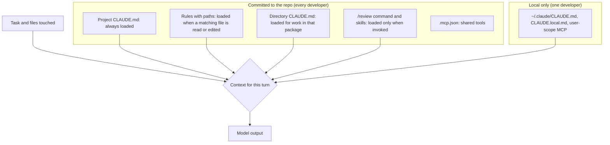

# Scenario 2: Code Generation with Claude Code

## Description

You are using Claude Code to accelerate software development. Your team uses it for code generation, refactoring, debugging, and documentation. You need to integrate it into your development workflow with custom slash commands, CLAUDE.md configurations, and understand when to use plan mode vs direct execution.

## Primary domains

- [Domain 3: Claude Code Configuration & Workflows](../../domains/03-claude-code-configuration-workflows/README.md)
- [Domain 5: Context Management & Reliability](../../domains/05-context-management-reliability/README.md)

## Sample questions

### Question 4

You want to create a custom `/review` slash command that runs your team's standard code review checklist. This command should be available to every developer when they clone or pull the repository. Where should you create this command file?

- A. In the `.claude/commands/` directory in the project repository
- B. In `~/.claude/commands/` in each developer's home directory
- C. In the `CLAUDE.md` file at the project root
- D. In a `.claude/config.json` file with a `commands` array

**Correct: A.** Project-scoped custom slash commands live in `.claude/commands/` within the repository; they are version-controlled and automatically available to all developers. B is for personal commands not shared via version control. C is for project instructions and context, not command definitions. D describes a mechanism that doesn't exist in Claude Code.

Related: [3.2](../../domains/03-claude-code-configuration-workflows/3.2-slash-commands-skills.md)

### Question 5

You've been assigned to restructure the team's monolithic application into microservices. This will involve changes across dozens of files and requires decisions about service boundaries and module dependencies. Which approach should you take?

- A. Enter plan mode to explore the codebase, understand dependencies, and design an implementation approach before making changes.
- B. Start with direct execution and make changes incrementally, letting the implementation reveal the natural service boundaries.
- C. Use direct execution with comprehensive upfront instructions detailing exactly how each service should be structured.
- D. Begin in direct execution mode and only switch to plan mode if you encounter unexpected complexity during implementation.

**Correct: A.** Plan mode is designed for complex tasks involving large-scale changes, multiple valid approaches, and architectural decisions. It enables safe exploration and design before committing to changes. B risks costly rework when dependencies are discovered late. C assumes you already know the right structure without exploring the code. D ignores that the complexity is already stated in the requirements.

Related: [3.4](../../domains/03-claude-code-configuration-workflows/3.4-plan-mode-vs-direct.md)

### Question 6

Your codebase has distinct areas with different coding conventions: React components use functional style with hooks, API handlers use async/await with specific error handling, and database models follow a repository pattern. Test files are spread throughout the codebase alongside the code they test (e.g., `Button.test.tsx` next to `Button.tsx`), and you want all tests to follow the same conventions regardless of location. What's the most maintainable way to ensure Claude automatically applies the correct conventions when generating code?

- A. Create rule files in `.claude/rules/` with YAML frontmatter specifying glob patterns to conditionally apply conventions based on file paths
- B. Consolidate all conventions in the root `CLAUDE.md` file under headers for each area, relying on Claude to infer which section applies
- C. Create skills in `.claude/skills/` for each code type that include the relevant conventions in their `SKILL.md` files
- D. Place a separate `CLAUDE.md` file in each subdirectory containing that area's specific conventions

**Correct: A.** `.claude/rules/` with glob patterns (e.g., `**/*.test.tsx`) applies conventions based on file paths regardless of directory location, which is essential for test files spread throughout the codebase. B relies on inference, making it unreliable. C requires manual skill invocation or Claude choosing to load them, contradicting the need for automatic application. D can't easily handle files spread across many directories since CLAUDE.md files are directory-bound.

Related: [3.3](../../domains/03-claude-code-configuration-workflows/3.3-path-specific-rules.md), [3.1](../../domains/03-claude-code-configuration-workflows/3.1-claude-md-hierarchy.md)

## Code snippets

This scenario is configuration, not application code. Below is a complete repository layout for a team using Claude Code, built from [3.1](../../domains/03-claude-code-configuration-workflows/3.1-claude-md-hierarchy.md) to [3.5](../../domains/03-claude-code-configuration-workflows/3.5-iterative-refinement.md).

### Layout

```text
repo/
├── CLAUDE.md                          project standards, committed
├── CLAUDE.local.md                    personal, gitignored
├── .mcp.json                          shared MCP servers, secrets via ${ENV}
├── .claude/
│   ├── commands/review.md             /review for everyone who clones (Q4)
│   ├── rules/
│   │   ├── testing.md                 paths: **/*.test.tsx, **/*.test.ts   (Q6)
│   │   ├── api-conventions.md         paths: src/api/**/*.ts
│   │   └── components.md              paths: src/components/**/*.tsx
│   └── skills/codebase-analysis/SKILL.md      context: fork
└── packages/billing/CLAUDE.md         directory-level, imports only what it needs
~/.claude/CLAUDE.md                    your personal preferences; teammates never see this
```

### `CLAUDE.md`

```markdown
# Project standards

## Commands
- Install: `pnpm install`
- Test: `pnpm test` (run before every commit)
- Lint: `pnpm lint`

## Conventions
- TypeScript strict mode; no `any` without a comment explaining why
- 2-space indentation
- API handlers live in `src/api/handlers/`
- Never commit secrets; read them from the environment

## Summary instructions
When summarising this conversation, always preserve: the task objective, file paths read or modified,
test results and error messages, and decisions with their reasoning.

See @docs/git-workflow.md for branching and commit rules.
```

### `.claude/commands/review.md`

```markdown
---
description: Run the team code review checklist on the current changes
argument-hint: [branch-or-path]
---

Review $ARGUMENTS (default: the uncommitted changes) against this checklist:

1. Error handling on every external call
2. No secrets or credentials in code
3. New branches are covered by tests
4. Public API changes are documented

Report only bugs and security issues. For each finding give: location, issue, severity, suggested fix.
```

### Path-scoped rules (automatic, by file path)

```markdown
<!-- .claude/rules/testing.md -->
---
paths:
  - "**/*.test.tsx"
  - "**/*.test.ts"
---
# Test conventions
- Colocate tests: Button.test.tsx next to Button.tsx
- React Testing Library; no snapshot tests
- One behaviour per test, Arrange / Act / Assert
```

```markdown
<!-- .claude/rules/api-conventions.md -->
---
paths: ["src/api/**/*.ts"]
---
# API handlers
- async/await with the shared `handleError` wrapper
- Validate input with zod before touching the database
- Return the standard `{ error: { code, message } }` shape
```

```markdown
<!-- .claude/rules/components.md -->
---
paths: ["src/components/**/*.tsx"]
---
# React components
- Function components with hooks; no class components
- Props typed with an exported interface
```

Why rules and not per-directory CLAUDE.md for tests: test files sit next to their code in dozens of directories, and a directory-level file cannot cover that.

### `.claude/skills/codebase-analysis/SKILL.md`

```yaml
---
name: codebase-analysis
description: Analyse how a module is organised and summarise its dependencies and risks. Use when asked to understand an area of the codebase.
context: fork
agent: Explore
argument-hint: [module-path]
allowed-tools: Read Grep Glob
---

Analyse $ARGUMENTS:
1. Find entry points with Grep
2. Read the files they import
3. Return a summary: purpose, public API, dependencies, risks, with file references
```

### `packages/billing/CLAUDE.md`

```markdown
@../../docs/standards/typescript.md
@../../docs/standards/payments-compliance.md
```

### `.mcp.json`

```json
{
  "mcpServers": {
    "github": {
      "type": "http",
      "url": "https://api.githubcopilot.com/mcp/",
      "headers": { "Authorization": "Bearer ${GITHUB_TOKEN}" }
    }
  }
}
```

Personal experiments go to your user scope instead: `claude mcp add --transport http hubspot --scope user https://mcp.hubspot.com/anthropic`.

### Working sessions

```text
# Monolith -> microservices (Q5): architectural, dozens of files, several valid designs
# (plan mode: read-only exploration, so a wrong boundary costs a discarded plan, not a revert)
claude --permission-mode plan
> Explore the monolith, map module dependencies, and propose service boundaries.
  (review and approve the plan, then implement in direct mode, step by step)

# Single-file fix with a clear stack trace: direct execution
# (scope is known, so a planning phase only adds latency)
> Fix the NaN in src/api/handlers/invoices.ts:42 (stack trace below)...

# Unfamiliar domain: interview first
> I need a cache for product lookups. Interview me about invalidation, failure modes and TTLs before you write code.

# Verbose discovery: keep it out of the main context
# (the forked skill returns only its summary, so file reads never accumulate here)
> /codebase-analysis packages/billing
```

### Verify the setup

```text
/memory           which CLAUDE.md / CLAUDE.local.md / rules are in play
/context all     "Memory files" must list the project CLAUDE.md
claude --debug    shows a rule whose frontmatter failed to parse (it would load with no `paths`)
```

If a new teammate does not follow the standards, check whether the instructions live in `~/.claude/CLAUDE.md` instead of the project file.

## Commentary: the architecture behind the code

SDK, CLI and config names are illustrative; the exam tests the reasoning, not the exact parameter.

### How the pieces fit together

This scenario is a question of scope and timing: who should receive an instruction, and when should it enter the context. Every artefact in the layout answers one of those two questions. Shared artefacts (project `CLAUDE.md`, commands, rules, skills, `.mcp.json`) are committed, so they reach every developer on clone. Personal artefacts (`~/.claude/CLAUDE.md`, `CLAUDE.local.md`, user-scope MCP servers) stay local. Within the shared set, timing differs: always-loaded context, context loaded only when matching files are touched, and content loaded only when someone invokes it. Choosing the wrong slot produces either missing conventions (not shared, not loaded) or a bloated context (always loaded, rarely relevant). Plan mode versus direct execution is the same idea applied to a working session: how much exploration to buy before committing to edits.



### Extended walk-through

A new developer clones the repository and is asked to extract the billing code into its own service.

1. **Clone.** Project `CLAUDE.md`, `.claude/commands/`, `.claude/rules/`, `.claude/skills/` and `.mcp.json` arrive with the repository; nothing needs to be configured by hand. The `~/.claude` directory stays on each machine, which is why standards placed there never reach teammates.
2. **Session start.** Project `CLAUDE.md` loads: build and test commands, short conventions, and summary instructions that protect file paths, test results and decisions if the conversation is later compacted.
3. **Scoping the task.** The change spans dozens of files and has several valid designs. The developer starts in plan mode, which explores without editing. This is exploration paid for before any edit exists to undo (Q5).
4. **Discovery.** `/codebase-analysis packages/billing` runs in a forked context and returns a summary. The raw file reads never enter the main conversation. Working inside `packages/billing` also pulls in that directory's `CLAUDE.md`, which imports the payments-compliance standard from a single source.
5. **Approval and execution.** The plan is reviewed, then implementation proceeds in direct mode. Editing `src/api/handlers/invoices.ts` loads the API rule; adding `invoices.test.ts` loads the test rule. Nobody types "follow the test conventions": the file path triggers it (Q6).
6. **Review.** `/review` applies the checklist to the uncommitted changes and reports only bugs and security issues. The command guarantees the checklist is available and identical for everyone; it does not guarantee the model applies every item. If a rule must block a merge, it belongs in CI (scenario 5), not in a prompt.

Failure paths:

- **Standards in the wrong place.** The teammate who wrote the conventions put them in `~/.claude/CLAUDE.md`; nobody else follows them. `/memory` shows which files load; the fix is moving them to the project file.
- **Rule silently inactive or over-active.** A glob too narrow never matches new test files, so conventions are absent without any error. Invalid frontmatter loads the rule without `paths`, so it applies everywhere. Debug output reveals the second case; checking pattern reach reveals the first.
- **Wrong mode for the task.** Starting a microservice split in direct mode means boundaries are discovered after edits exist, and the wrong ones are expensive to unwind. Conversely, planning a one-line stack-trace fix adds latency with no benefit.
- **Long session degradation.** Verbose exploration in the main context crowds out earlier decisions; forking the discovery and keeping summary instructions in `CLAUDE.md` address this.
- **Credentials.** `.mcp.json` references `${GITHUB_TOKEN}` rather than a literal, so the committed file contains no secret.

### Design decisions and trade-offs

- **Shared command in `.claude/commands/` (Q4).** Version control is the distribution mechanism: clone or pull equals update. The alternative, home-directory commands, scales only by asking each developer to copy files and drifts as the checklist changes. Personal commands belong there when they are genuinely personal.
- **Path-scoped rules for conventions that follow file type (Q6).** The pattern follows the files wherever they sit and loads only when relevant. Subdirectory `CLAUDE.md` files win when a convention is tied to one package; one root file with headers wins only for small projects where everything is always relevant, but it relies on inference and costs tokens every session.
- **Plan mode when scope is architectural (Q5).** The trigger is known uncertainty at the outset: many files, several valid designs, decisions that propagate. Direct mode wins for well-scoped changes. "Start direct and switch if it gets hard" fails because the complexity was already visible in the requirements.
- **Forked skill for noisy exploration.** Isolation keeps the main context small and returns a compact result. The price is that details not in the summary are gone; if the main session needs the raw material, run the exploration inline.
- **`@import` for shared standards.** One source of truth for rules reused across packages. The trade-off is that imported text still loads, so import only what a package needs.
- **Guidance versus enforcement.** `CLAUDE.md`, rules and commands shape behaviour probabilistically. Hooks or CI enforce. The scenario uses the first group because style conventions tolerate occasional misses; security-critical checks do not.

### Exam traps in this scenario

- **Q4, B (`~/.claude/commands/`):** personal scope, not shared by version control. Rule: configuration the team must share lives in the repository.
- **Q4, C (command in `CLAUDE.md`) and D (`config.json` with a `commands` array):** one is the wrong artefact type (context, not command definitions); the other describes a mechanism that does not exist. Rule: distrust options that invent configuration formats.
- **Q5, B (direct, let boundaries emerge) and D (direct, switch if complex):** both defer the thinking until edits exist. Rule: when architectural complexity is stated, plan first.
- **Q5, C (direct with exhaustive upfront instructions):** assumes the answer without exploring the code. Rule: specification is not exploration.
- **Q6, B (headers in the root `CLAUDE.md`):** relies on inference and always-loaded cost. Rule: prefer deterministic scoping to model inference.
- **Q6, C (skills per code type):** skills must be invoked or selected; conventions that must apply automatically do not fit. Rule: automatic requirements need automatic loading.
- **Q6, D (a `CLAUDE.md` per directory):** directory-bound, so it cannot cover tests spread across the tree. Rule: match the scoping unit (file pattern or directory) to how the convention is distributed.
- Likely further distractors: documenting the command in the README and asking people to paste it; putting team standards in `~/.claude/CLAUDE.md`; using a skill for an always-on convention; committing a literal token in `.mcp.json` for convenience; relying on a rule to guarantee a security check instead of a hook or CI. Rule: guidance is not enforcement, and personal scope is not team scope.

### Check yourself

- **A convention is "tests use React Testing Library, no snapshots", and tests sit beside source across 40 folders. Which mechanism, and why not the alternatives?** A rule with `paths` globs on the test file patterns. A directory file would be copied 40 times, a skill would need invocation, and root headers depend on inference.
- **A developer says Claude ignores the team's standards on their machine only. What do you check first?** Whether the standards live in someone's user-level file rather than the committed project file, then which files `/memory` reports as loaded.
- **When is plan mode the wrong choice?** Well-scoped changes with clear location and cause, such as fixing a NaN from a stack trace. The exploration buys nothing and delays the fix.
- **Why not encode the code review checklist as a rule instead of a command?** A rule would load automatically on matching edits as guidance, which suits conventions; a review is an on-demand activity over a change set, so an invoked command fits. Neither is enforcement: a blocking check needs CI.
