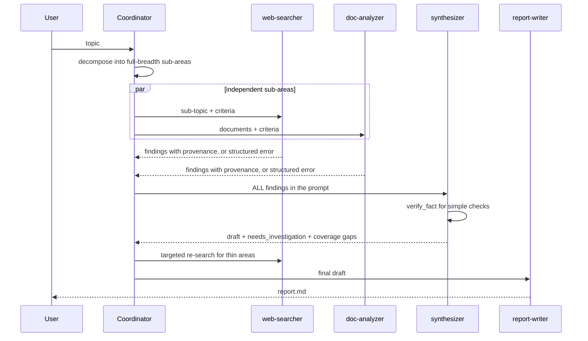

# Scenario 3: Multi-Agent Research System

## Description

You are building a multi-agent research system using the Claude Agent SDK. A coordinator agent delegates to specialized subagents: one searches the web, one analyzes documents, one synthesizes findings, and one generates reports. The system researches topics and produces comprehensive, cited reports.

## Primary domains

- [Domain 1: Agentic Architecture & Orchestration](../../domains/01-agentic-architecture-orchestration/README.md)
- [Domain 2: Tool Design & MCP Integration](../../domains/02-tool-design-mcp-integration/README.md)
- [Domain 5: Context Management & Reliability](../../domains/05-context-management-reliability/README.md)

## Sample questions

### Question 7

After running the system on the topic "impact of AI on creative industries," you observe that each subagent completes successfully: the web search agent finds relevant articles, the document analysis agent summarizes papers correctly, and the synthesis agent produces coherent output. However, the final reports cover only visual arts, completely missing music, writing, and film production. When you examine the coordinator's logs, you see it decomposed the topic into three subtasks: "AI in digital art creation," "AI in graphic design," and "AI in photography." What is the most likely root cause?

- A. The synthesis agent lacks instructions for identifying coverage gaps in the findings it receives from other agents.
- B. The coordinator agent's task decomposition is too narrow, resulting in subagent assignments that don't cover all relevant domains of the topic.
- C. The web search agent's queries are not comprehensive enough and need to be expanded to cover more creative industry sectors.
- D. The document analysis agent is filtering out sources related to non-visual creative industries due to overly restrictive relevance criteria.

**Correct: B.** The coordinator's logs reveal the root cause: it decomposed "creative industries" into only visual arts subtasks. The subagents executed their assigned tasks correctly; the problem is what they were assigned. A, C, and D blame downstream agents that are working correctly within their scope.

Related: [1.2](../../domains/01-agentic-architecture-orchestration/1.2-coordinator-subagent-patterns.md)

### Question 8

The web search subagent times out while researching a complex topic. You need to design how this failure information flows back to the coordinator agent. Which error propagation approach best enables intelligent recovery?

- A. Return structured error context to the coordinator including the failure type, the attempted query, any partial results, and potential alternative approaches.
- B. Implement automatic retry logic with exponential backoff within the subagent, returning a generic "search unavailable" status only after all retries are exhausted.
- C. Catch the timeout within the subagent and return an empty result set marked as successful.
- D. Propagate the timeout exception directly to a top-level handler that terminates the entire research workflow.

**Correct: A.** Structured error context lets the coordinator decide whether to retry with a modified query, try an alternative approach, or proceed with partial results. B's generic status hides valuable context. C suppresses the error by marking failure as success, preventing recovery. D terminates the workflow unnecessarily.

Related: [5.3](../../domains/05-context-management-reliability/5.3-error-propagation.md), [2.2](../../domains/02-tool-design-mcp-integration/2.2-structured-error-responses.md)

### Question 9

During testing, you observe that the synthesis agent frequently needs to verify specific claims while combining findings. Currently, when verification is needed, the synthesis agent returns control to the coordinator, which invokes the web search agent, then re-invokes synthesis with results. This adds 2-3 round trips per task and increases latency by 40%. Your evaluation shows that 85% of these verifications are simple fact-checks (dates, names, statistics) while 15% require deeper investigation. What's the most effective approach to reduce overhead while maintaining system reliability?

- A. Give the synthesis agent a scoped `verify_fact` tool for simple lookups, while complex verifications continue delegating to the web search agent through the coordinator.
- B. Have the synthesis agent accumulate all verification needs and return them as a batch to the coordinator at the end of its pass, which then sends them all to the web search agent at once.
- C. Give the synthesis agent access to all web search tools so it can handle any verification need directly without round-trips through the coordinator.
- D. Have the web search agent proactively cache extra context around each source during initial research, anticipating what the synthesis agent might need to verify.

**Correct: A.** Applies least privilege: the synthesis agent gets only what it needs for the 85% common case while the existing coordination pattern handles complex cases. B creates blocking dependencies since synthesis steps may depend on earlier verified facts. C over-provisions the synthesis agent, violating separation of concerns. D relies on speculative caching that cannot reliably predict what needs verifying.

Related: [2.3](../../domains/02-tool-design-mcp-integration/2.3-tool-distribution-tool-choice.md)

## Code snippets

One file combining [1.2](../../domains/01-agentic-architecture-orchestration/1.2-coordinator-subagent-patterns.md), [1.3](../../domains/01-agentic-architecture-orchestration/1.3-subagent-invocation-context-spawning.md), [2.2](../../domains/02-tool-design-mcp-integration/2.2-structured-error-responses.md), [2.3](../../domains/02-tool-design-mcp-integration/2.3-tool-distribution-tool-choice.md), [5.3](../../domains/05-context-management-reliability/5.3-error-propagation.md) and [5.6](../../domains/05-context-management-reliability/5.6-provenance-uncertainty.md). The search and fact-check backends are stubs; replace them with real APIs.

### `research_system.py`

```python
import asyncio
import json
from typing import Any

from claude_agent_sdk import (
    AgentDefinition, ClaudeAgentOptions, HookMatcher, ResultMessage, create_sdk_mcp_server, query, tool,
)

APPROVED_DOC_HOST = "https://docs.example.com/"


def ok(payload: dict) -> dict[str, Any]:
    return {"content": [{"type": "text", "text": json.dumps(payload)}]}


def fail(payload: dict) -> dict[str, Any]:
    return {"content": [{"type": "text", "text": json.dumps(payload)}], "is_error": True}


# ---------- stub backends ----------
async def search_backend(query_text: str) -> list[dict]:
    if "music" in query_text.lower():
        raise TimeoutError                                   # simulate an outage to exercise error propagation
    return [{"claim": f"Finding about {query_text}", "evidence_excerpt": "…",
             "source_url": "https://example.com/a", "published": "2025-06-01"}]


async def fact_backend(claim: str) -> dict:
    return {"verified": True, "value": "…", "source_url": "https://example.com/fact", "published": "2025-01-01"}


# ---------- tools ----------
@tool("web_search",
      "Search the web for ONE sub-topic and return findings, each with claim, evidence_excerpt, source_url and "
      "published date. Use for discovery. For checking a single known fact use verify_fact instead.",
      {"query": str})
async def web_search(args):
    last = None
    for _ in range(3):                                       # transient failures retried locally
        try:
            return ok({"status": "ok", "results": await search_backend(args["query"])})   # [] is a valid empty result
        except TimeoutError as e:
            last = e
    # surfaced only after local retries are spent, with enough context for the coordinator to pick a recovery
    return fail({"status": "error", "failure_type": "timeout", "attempted_query": args["query"],
                 "attempts": 3, "partial_results": [],
                 "alternatives": ["narrower query", "ask the doc-analyzer for this sub-topic"]})


@tool("verify_fact",
      "Check ONE simple fact (a date, name or statistic) against a source and return the value with its "
      "source_url and published date. Not for open-ended research; say so in your notes if deeper work is needed.",
      {"claim": str})
async def verify_fact(args):
    return ok(await fact_backend(args["claim"]))


@tool("load_document",
      f"Load a document from the approved store ({APPROVED_DOC_HOST}...) and return its text with document_name "
      "and page markers. Rejects any other URL.",
      {"url": str})
async def load_document(args):
    if not args["url"].startswith(APPROVED_DOC_HOST):   # trust boundary: the model picks the URL, code decides which hosts are allowed
        return fail({"errorCategory": "validation", "isRetryable": False, "message": "URL is not in the approved store."})
    return ok({"document_name": args["url"].rsplit("/", 1)[-1], "text": "…"})


research = create_sdk_mcp_server(name="research", tools=[web_search, verify_fact, load_document])

FINDING_FORMAT = (
    'Return ONLY a JSON list of findings: {"claim", "evidence_excerpt", "source_url" | null, '
    '"document_name" | null, "page" | null, "published" (ISO date), "methodology" | null}. '
    "If a source gives a different figure than another, include both with their dates; do not choose."
)

# ---------- subagents: scoped tools, structured output ----------
agents = {
    "web-searcher": AgentDefinition(
        description="Finds web sources for one sub-topic and returns structured findings.",
        prompt=f"Research the sub-topic you are given using web_search. {FINDING_FORMAT} "
               "If the tool reports an error, return the error object and any partial results unchanged.",
        tools=["mcp__research__web_search"],
    ),
    "doc-analyzer": AgentDefinition(
        description="Extracts claims from the provided documents with page references.",
        prompt=f"Analyse only the documents you are given (use load_document). {FINDING_FORMAT}",
        tools=["mcp__research__load_document"],           # no web access: its evidence base is the vetted store only
    ),
    "synthesizer": AgentDefinition(
        description="Merges the findings supplied in its prompt into a report draft. Use only after findings exist.",
        prompt="Combine the findings in your prompt. Keep source_url / document_name and published date with every claim. "
               "Report conflicting values side by side with attribution. For a simple fact-check use verify_fact; "
               "for anything deeper, list it under 'needs_investigation'. Structure: well-established findings, "
               "contested findings, coverage gaps.",
        tools=["mcp__research__verify_fact"],                 # no web_search: scoped cross-role tool only
    ),
    "report-writer": AgentDefinition(
        description="Writes the final cited report to report.md from the synthesized draft in its prompt.",
        prompt="Write report.md. Financial data as tables, news as prose, technical findings as lists. Keep every citation.",
        tools=["Write"],                                       # the only agent allowed to touch the filesystem
    ),
}

COORDINATOR_PROMPT = """You coordinate a research team that produces a cited report on the user's topic.

1. Decompose the topic into distinct, non-overlapping sub-areas covering the FULL breadth of the topic
   (for "AI in creative industries": visual arts, music, writing, film, games, ...). Use only the subagents the query needs.
2. Delegate independent sub-areas to web-searcher / doc-analyzer IN PARALLEL (several Agent calls in one response).
   Give each subagent its sub-topic and quality criteria; it cannot see this conversation.
3. Pass ALL findings, as JSON, in the synthesizer's prompt. Subagents do not share memory.
4. Read the draft for gaps. If a sub-area is thin or missing, re-delegate a targeted search and re-run the synthesizer.
   Repeat until coverage is sufficient.
5. If a subagent returns an error object, decide: retry with a changed query, route to another subagent, or proceed with
   partial results and list the topic under "Coverage gaps" with the reason.
6. Finish with report-writer. Do not invent claims that no finding supports."""


async def log_subagent(input_data, tool_use_id, context):
    print(f"[subagent done] {input_data['agent_type']} {input_data['agent_id']} -> {input_data['agent_transcript_path']}")
    return {}                                                  # observability only: never alters the run


options = ClaudeAgentOptions(
    system_prompt=COORDINATOR_PROMPT,
    mcp_servers={"research": research},
    allowed_tools=["Agent", "mcp__research__*", "Write"],     # subagents still get only the tool lists defined above
    agents=agents,
    hooks={"SubagentStop": [HookMatcher(hooks=[log_subagent])]},
    env={"CLAUDE_CODE_MAX_SUBAGENT_SPAWN_DEPTH": "1",          # subagents cannot spawn their own
         "CLAUDE_CODE_MAX_CONCURRENT_SUBAGENTS": "5"},
    max_budget_usd=5.0,                                        # hard cost stop that does not depend on model judgement
    max_turns=60,
)


async def main(topic: str) -> None:
    try:
        async for message in query(prompt=f"Research: {topic}", options=options):
            if isinstance(message, ResultMessage) and message.subtype == "success":
                print(message.result)
    except Exception as error:               # single-shot query() raises after an error result
        print(f"Run ended with an error: {error}")


if __name__ == "__main__":
    asyncio.run(main("The impact of AI on creative industries"))
```

### Why it is built this way

| Sample question | Where in the code |
| - | - |
| Q7: reports only cover visual arts | the coordinator prompt requires decomposition across the topic's full breadth, plus a gap-check loop |
| Q8: web search timeout | `web_search` retries locally, then returns `failure_type`, `attempted_query`, `partial_results`, `alternatives`; the coordinator prompt says what to do with them. Empty `results` stays a success |
| Q9: synthesis latency | `synthesizer` gets only `verify_fact`; complex verification goes back through the coordinator |

Other choices worth noticing:

- Findings are structured (claim, excerpt, source, date, methodology), so attribution survives synthesis (5.6).
- Subagents never talk to each other; everything routes through the coordinator.
- The coordinator sets goals and criteria, not step-by-step procedures, so subagents can adapt.
- Depth and concurrency limits come from environment variables, and `max_budget_usd` caps the whole tree.

Note that a subagent the coordinator spawns runs in the background by default; Claude waits for the result when its next step needs it. If you need strict ordering (search, then synthesise), say so in the coordinator prompt.

## Commentary: the architecture behind the code

SDK, CLI and config names are illustrative; the exam tests the reasoning, not the exact parameter.

### How the pieces fit together

The system is hub-and-spoke. The coordinator is the only component that sees the whole task, so it owns decomposition, delegation, gap detection and failure handling. Subagents are narrow workers with isolated context and a tool list that matches their role. They do not share memory and do not talk to each other, so everything a worker needs has to be written into its prompt and everything it learned has to come back as structured output. That constraint is what makes the system debuggable: each hop is visible in the coordinator's log, and the quality of the final report can be traced to a specific step (the decomposition, one subagent's output, or the synthesis).



### Extended walk-through

Topic: "The impact of AI on creative industries."

1. **Decomposition (model judgement, highest leverage).** The coordinator breaks the topic into visual arts, music, writing, film and games. Everything downstream inherits this list: if "music" is absent here, no later stage can add it. This is why Q7 points at the coordinator logs and not at the workers.
2. **Parallel delegation.** Independent sub-areas go to workers in one step. Each receives its sub-topic and quality criteria in its prompt, because it cannot see the conversation. Parallelism cuts latency; the isolation avoids cross-contamination between areas.
3. **Failure path: timeout.** The music search times out. The tool retries locally (transient faults should not bother the coordinator), then returns `failure_type`, `attempted_query`, `partial_results` and `alternatives`. The worker returns this unchanged. The coordinator can now choose: retry with a narrower query, route the sub-topic to the document analyzer, or proceed and list music under coverage gaps with the reason. A generic "search unavailable" would leave only "try again or give up".
4. **Failure path: policy violation.** The document analyzer is handed a URL outside the approved store. The tool rejects it as a non-retryable validation error. The category tells the coordinator not to retry the same call.
5. **Synthesis.** All findings, as JSON with source, date and methodology, go into the synthesizer's prompt. Two sources give different statistics: both are kept with their dates and attribution and placed under contested findings. Picking one silently would erase a real disagreement.
6. **Verification.** For a simple fact-check (a date, a name) the synthesizer calls `verify_fact` directly. This covers the common case without round trips. A deeper question goes into `needs_investigation`, and the coordinator handles it the long way.
7. **Gap check.** The coordinator reads the draft for thin or missing areas, re-delegates targeted searches and re-runs synthesis. The loop is model-driven, and the budget and turn limits bound it deterministically.
8. **Report.** The writer, the only agent holding a write tool, produces `report.md` with citations preserved.

Other failure paths: a subagent that drops source fields makes the synthesizer's claims unattributable (provenance must be part of the output contract); a vague sub-topic yields overlapping searches and duplicated cost; reaching the budget ends the run with an error result instead of looping.

### Design decisions and trade-offs

- **Coordinator mediates all communication.** Direct worker-to-worker calls would save hops but destroy observability and let errors propagate unnoticed. Hub-and-spoke costs latency but gives one place to log, retry and reroute. A pipeline of fixed stages wins when the task is always the same shape; here the coordinator must adapt to what the findings show.
- **Context passed explicitly, not shared.** Workers start clean, so the prompt must contain the findings and criteria. This costs tokens and discipline. The benefit is isolation: a worker cannot be misled by unrelated conversation, and its context stays small.
- **A scoped `verify_fact` tool for the synthesizer (Q9).** It removes 2-3 round trips for the 85% of checks that are simple. The alternative of giving it all web tools would erase role boundaries and make synthesis behave like a second searcher; the 15% of deep checks still route through the coordinator. Full tool access would win only if verification were almost always deep and latency mattered more than separation.
- **Local retry, then structured error (Q8).** Transient faults are cheap to retry close to the source; what survives retries is information the coordinator needs in full to decide. Swallowing the failure as an empty success makes a coverage hole look like a fact ("nothing exists"), and terminating the whole run throws away the findings already obtained.
- **Coordinator prompt states goals and criteria, not procedures.** Subagents adapt to what they find, and the coordinator loop can react to gaps. A rigid script is more predictable but fails on unexpected topics. Hard limits (depth, concurrency, budget) live in configuration, not in prose.
- **Structured findings with provenance.** Claim, excerpt, source, date and methodology survive synthesis and enable attribution of conflicts. The cost is a stricter output contract on every worker; the alternative of free-form summaries loses sources and cannot support a reliable bibliography.

### Exam traps in this scenario

- **Q7, A, C, D (blame the synthesizer, search or analyzer):** each worker did its assigned job; the logs show the decomposition was narrow. Rule: trace a symptom to the first stage where it appears before changing downstream components.
- **Q8, B (generic status after retries):** hides failure type, query and partial results. Rule: errors crossing an agent boundary carry context the next decision-maker needs.
- **Q8, C (empty result marked successful):** disguises a failure as a valid answer, so the coordinator cannot recover. Rule: distinguish "no results" from "could not search".
- **Q8, D (terminate the workflow):** discards partial progress for a recoverable fault. Rule: let the component with the widest view decide whether to continue.
- **Q9, B (batch all verifications to the end):** later synthesis steps may depend on earlier verified facts, so batching introduces blocking dependencies. Rule: batching suits independent, non-blocking work.
- **Q9, C (all web tools for synthesis):** over-provisioning that blurs roles. Rule: least privilege per subagent; add the narrowest tool that covers the common case.
- **Q9, D (proactive caching of extra context):** speculative and unreliable, inflating context. Rule: do not pay for prediction when a direct, scoped capability exists.
- Likely further distractors: letting subagents inherit the coordinator's history ("so they know the goal"), which defeats isolation and bloats context; letting subagents call each other; averaging or silently selecting among conflicting figures; raising `max_turns` to compensate for poor coverage; a stronger model for synthesis to fix a decomposition fault; running sequentially "for reliability" when sub-areas are independent. Rule: fix structure and information flow before spending more compute.

### Check yourself

- **Reports are polished but miss a whole sector, and every subagent log looks healthy. Where do you look first and what do you change?** The coordinator's decomposition. Change its prompt to require full-breadth sub-areas and add a gap-check step; the workers are not at fault.
- **A search worker times out. Why return a structured error instead of retrying forever inside the worker?** Local retries handle transient faults, but beyond that the coordinator has options the worker lacks (different query, different agent, partial results). It needs failure type, attempted query and partial output to pick one.
- **Why does the synthesizer get `verify_fact` and not `web_search`?** The evaluation shows most verifications are simple lookups; a narrow tool removes the round trips for those while keeping search and deep investigation in their own role. Full search access would blur responsibilities and widen what the synthesizer can do wrong.
- **Two sources report different figures for the same statistic. What should the final report do?** Present both with source, date and methodology, flagged as contested, rather than choosing one. Choosing silently hides uncertainty and cannot be audited.
