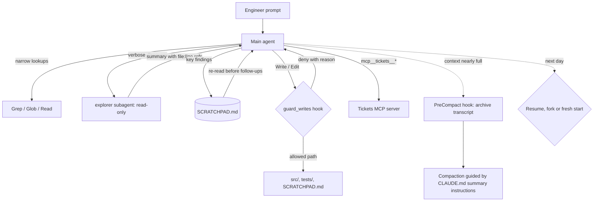

# Scenario 4: Developer Productivity with Claude

## Description

You are building developer productivity tools using the Claude Agent SDK. The agent helps engineers explore unfamiliar codebases, understand legacy systems, generate boilerplate code, and automate repetitive tasks. It uses the built-in tools (Read, Write, Bash, Grep, Glob) and integrates with Model Context Protocol (MCP) servers.

## Primary domains

- [Domain 2: Tool Design & MCP Integration](../../domains/02-tool-design-mcp-integration/README.md)
- [Domain 3: Claude Code Configuration & Workflows](../../domains/03-claude-code-configuration-workflows/README.md)
- [Domain 1: Agentic Architecture & Orchestration](../../domains/01-agentic-architecture-orchestration/README.md)

## Sample questions

_None provided in the exam guide for this scenario._

## Code snippets

A developer-productivity agent built on the Agent SDK with the built-in tools plus an MCP server. It combines [1.7](../../domains/01-agentic-architecture-orchestration/1.7-session-state-resumption-forking.md), [2.4](../../domains/02-tool-design-mcp-integration/2.4-mcp-server-integration.md), [2.5](../../domains/02-tool-design-mcp-integration/2.5-built-in-tools.md), [3.4](../../domains/03-claude-code-configuration-workflows/3.4-plan-mode-vs-direct.md) and [5.4](../../domains/05-context-management-reliability/5.4-codebase-exploration-context.md).

### `.mcp.json` (shared, no secrets in git)

```json
{
  "mcpServers": {
    "tickets": {
      "type": "http",
      "url": "https://mcp.example.com/mcp",
      "headers": { "Authorization": "Bearer ${TICKETS_TOKEN}" }
    }
  }
}
```

### `dev_assistant.py`

```python
import asyncio
import shutil
from pathlib import Path

from claude_agent_sdk import (
    AgentDefinition, ClaudeAgentOptions, HookMatcher, ResultMessage, query,
)

ROOT = Path.cwd().resolve()
WRITABLE = [ROOT / "src", ROOT / "tests", ROOT / "SCRATCHPAD.md"]   # allow-list: anything not named is denied by default
ARCHIVE = ROOT / ".agent_archive"


def deny(reason: str) -> dict:
    return {"hookSpecificOutput": {"hookEventName": "PreToolUse", "permissionDecision": "deny",
                                   "permissionDecisionReason": reason}}


async def guard_writes(input_data, tool_use_id, context):
    target = Path(input_data["tool_input"].get("file_path", "")).resolve()   # resolve first so ../ and symlinks cannot slip past the check
    if any(target == p or p in target.parents for p in WRITABLE):
        return {}
    return deny(f"Writes are limited to src/, tests/ and SCRATCHPAD.md (got {target}).")


async def archive_before_compact(input_data, tool_use_id, context):
    ARCHIVE.mkdir(exist_ok=True)   # compaction is lossy: keep the full transcript so detail can be recovered or audited
    shutil.copy(input_data["transcript_path"], ARCHIVE / f"{input_data['session_id']}-{input_data['trigger']}.jsonl")
    return {}


SYSTEM_APPEND = """You help engineers explore unfamiliar code, understand legacy systems and generate boilerplate.

Explore incrementally: Grep for entry points, Read the files they import, trace one flow at a time. Never read the
whole repo up front. Find files with Glob, find code with Grep.
Delegate verbose discovery to the `explorer` subagent and ask it for a summary with file:line references only.
Keep SCRATCHPAD.md current: after each step record files examined, key classes (with paths), data flow and open
questions. Re-read it before answering follow-up questions. Name specific classes, not "typical patterns".
If Edit fails because the anchor text is not unique, Read the file and Write the changed version instead."""

options = ClaudeAgentOptions(
    system_prompt={"type": "preset", "preset": "claude_code", "append": SYSTEM_APPEND},
    setting_sources=["project"],              # loads CLAUDE.md, .claude/rules, .mcp.json
    # Bash stays limited to read-only git: the write guard only sees Write/Edit, so a broad shell would bypass it
    allowed_tools=["Read", "Grep", "Glob", "Write", "Edit", "Agent",
                   "Bash(git log *)", "Bash(git diff *)", "mcp__tickets__*"],
    disallowed_tools=["Bash(rm *)"],
    agents={
        "explorer": AgentDefinition(
            description="Read-only investigator for one specific question about the codebase.",
            prompt="Answer the question wit   # read-only: investigation cannot change the repo, and its file reads stay out of the main contexth specific file paths and line numbers. Return a short summary, not file contents.",
            tools=["Read", "Grep", "Glob"],
        ),
    },
    hooks={
        "PreToolUse": [HookMatcher(matcher="Write|Edit", hooks=[guard_writes])],
        "PreCompact": [HookMatcher(hooks=[archive_before_compact])],
    },
    max_turns=40,
)


async def ask(prompt: str, **overrides) -> str | None:
    """Run one prompt and return the session ID so the next call can resume it."""
    session_id = None
    opts = ClaudeAgentOptions(**{**options.__dict__, **overrides})
    try:
        async for message in query(prompt=prompt, options=opts):
            if isinstance(message, ResultMessage):
                session_id = message.session_id
                if message.subtype == "success":
                    print(message.result)
    except Exception as error:                # single-shot query() raises after an error result
        print(f"Ended with an error: {error}")
    return session_id


async def main() -> None:
    # 1. Understand a legacy flow (plan mode: explore, do not edit)
    sid = await ask("Trace how refunds are processed end to end. Record findings in SCRATCHPAD.md.",
                    permission_mode="plan")

    # 2. Follow-up in the same session; tell it what changed since the analysis
    sid = await ask("payments/refunds.py changed since your analysis (rounding moved to money.py). "
                    "Re-read only those files, update SCRATCHPAD.md, then generate a unit-test skeleton for process_refund.",
                    resume=sid)

    # 3. Fork to try an alternative without losing the baseline
    await ask("Instead, sketch how this flow would look as an event handler.", resume=sid, fork_session=True)


if __name__ == "__main__":
    asyncio.run(main())
```

### Choosing between the built-in tools

| Question | Tool |
| - | - |
| Where is `process_refund` called? | `Grep` for the name, then `Read` the hits |
| Which files are tests? | `Glob` `**/*.test.*` |
| What does this module import? | `Read` the file, then `Grep` each exported name across the repo |
| Change one line at a unique spot | `Edit` |
| `Edit` cannot find a unique anchor | `Read` the file, then `Write` the new version |

### Notes

- The write guard is a `PreToolUse` hook, so it holds even if Claude ignores the prompt. `permission_mode="plan"` only applies to the first call here; later calls run in the default mode.
- MCP tools need an explicit allow (`mcp__tickets__*`); give them rich descriptions so Claude prefers them over Grep where they are better.
- The scratchpad plus `/compact` and the `PreCompact` archive hook counter context degradation in long sessions.
- A resumed session is told which files changed rather than re-exploring everything; if most tool results are stale, start fresh with an injected summary instead.

## Commentary: the architecture behind the code

SDK, CLI and config names are illustrative; the exam tests the reasoning, not the exact parameter.

### How the pieces fit together

This scenario has no single dramatic decision; it is about keeping one long, exploratory session useful and safe. Three problems recur: context fills with discovery output, state goes stale or is lost, and a capable agent with write access needs boundaries. The design answers each with a different layer. Context is protected by incremental exploration, a read-only `explorer` subagent and a scratchpad file. State is managed by resume, fork or a fresh start, chosen by how much of the prior context is still valid. Safety is enforced by a hook with an allow-list and by a narrowly scoped shell, not by instructions the model might ignore. MCP tools extend the agent beyond the repository (here, tickets) and are configured at project scope so every developer gets the same set.



### Extended walk-through

An engineer new to the repository asks how refunds work end to end.

1. **Setup.** Project settings load `CLAUDE.md`, rules and `.mcp.json`. The tickets token comes from an environment variable, so the committed file has no secret.
2. **Exploration in plan mode.** The task is understanding, not changing. The agent greps for `process_refund`, reads the hits, then reads what they import, tracing one flow at a time. It never loads the repository up front: that would consume the context it needs for reasoning.
3. **Delegating noise.** "Where else is `RefundPolicyChecker` used?" spans many files. The `explorer` subagent, which has only read tools, runs the searches in its own context and returns file and line references. The main context receives a short answer instead of dozens of tool results.
4. **Externalising memory.** After each step the agent records files examined, key classes with paths, data flow and open questions in `SCRATCHPAD.md`, and re-reads it before follow-ups. This is the guard against the degradation symptom of answering with "typical patterns" instead of the classes it actually found.
5. **Going beyond code.** A ticket mentions rounding. The agent uses the MCP tickets tool, whose description tells it when to prefer it over searching the repository.
6. **Long session.** Context fills; compaction is triggered. The `PreCompact` hook archives the raw transcript first, and the summary instructions in `CLAUDE.md` tell compaction to keep the objective, touched files, test results and decisions with reasoning.
7. **Next day.** A teammate has changed `refunds.py`. The engineer resumes the session and says which files changed so the agent re-reads only those, rather than reasoning from stale earlier reads.
8. **Alternative design.** Forking the session explores an event-handler version from the same analysis without disturbing the baseline.

Failure paths:

- **Write outside the allowed area.** A request to edit a config file hits `guard_writes`; the path is resolved, found outside the allow-list, and denied with a reason. The agent can explain the limit rather than silently skipping.
- **Destructive shell command.** `rm` is denied, and Bash is otherwise limited to read-only git subcommands, so the write guard cannot be bypassed through the shell.
- **Non-unique edit anchor.** `Edit` fails because the anchor text appears twice; the fallback is to read the file and write the updated version.
- **Mostly stale session.** If many files changed, resuming is worse than starting fresh with a summary of verified conclusions and a list of what changed.
- **Fork that writes files.** A fork isolates the conversation, not the working tree; an exploratory branch that edits files changes state for every branch.

### Design decisions and trade-offs

- **Purpose-built tools for each question.** Grep finds content, Glob finds names, Read inspects a file, Edit changes a unique spot and Read plus Write is the fallback. The alternative of routing everything through shell commands loses the structured results and the permission granularity. A shell wins only for tasks no dedicated tool covers.
- **Incremental exploration plus subagent delegation.** Cost is some extra startup and a summary that omits detail. The alternatives, reading the whole repository first or relying on a bigger window, spend context on material that is never needed and do not stop long-session degradation.
- **Scratchpad and archive rather than conversational memory.** Files are inspectable, survive compaction and crashes, and let the agent re-ground itself. The price is the discipline of keeping it current. Compaction alone is automatic but unpredictable about which details survive.
- **Hook-enforced allow-list for writes.** The rule "only `src/`, `tests/` and the scratchpad" must always hold, so it is code, evaluated before the tool runs. A prompt instruction would usually be followed and sometimes not. An allow-list is safer than a deny-list because unanticipated paths are blocked by default.
- **Project-scoped MCP with environment-expanded secrets.** Shared tools in `.mcp.json` give every developer the same capabilities; user scope suits personal experiments. Rich tool descriptions matter because the model chooses between MCP and built-in tools by reading them.
- **Resume, fork or start fresh by validity of prior context.** Resume when little has changed and tell the agent what did; fork when comparing approaches from a shared baseline; start fresh with a summary when most tool results are stale. Always resuming is convenient and risks confident answers from outdated reads.

### Exam traps in this scenario

The exam guide provides no sample questions for this scenario, so the traps below are the plausible wrong answers for its task statements (1.7, 2.4, 2.5, 3.4, 5.4), not quotations.

- **"Read the entire repository first so nothing is missed."** Exhausts context and speeds degradation. Rule: explore incrementally and delegate verbose discovery.
- **"Use a larger context window."** Bigger windows still degrade and do not survive a crash. Rule: persist key findings externally.
- **"Let the subagent return everything it read."** Defeats the isolation it exists for. Rule: ask for summaries with specific references.
- **"Tell the agent in the prompt not to modify other directories."** Probabilistic. Rule: enforce in code what must always hold.
- **"Give the explorer write tools in case it needs them."** Rule: least privilege per subagent; an investigator does not need to change anything.
- **"Resume the old session; the agent will notice changed files."** It cannot see edits made outside the session. Rule: stale tool results are a hazard; inform the agent or start fresh.
- **"Fork to try risky changes safely."** A fork isolates conversation, not files. Rule: know exactly what a mechanism isolates.
- **"Commit the API token in `.mcp.json` so teammates have it."** Rule: secrets come from the environment, shared configuration is committed, personal configuration is local.
- **"Start in direct mode on an unfamiliar legacy system."** Rule: exploration of unknown structure is the plan-mode use case.

### Check yourself

- **Two hours into an investigation, the agent starts answering with generic patterns instead of the classes it found earlier. What is happening and what are two mitigations?** Context degradation. Keep a scratchpad with specific paths and re-read it; delegate verbose exploration to a subagent and compact with summary instructions that preserve key facts.
- **Why is the write restriction a hook and not a line in the system prompt?** It must hold even when the model misjudges or is persuaded otherwise; a pre-execution hook is deterministic, testable without the model and cannot be talked out of a decision.
- **After a teammate's refactor, when do you resume the session and when do you start fresh?** Resume with an explicit list of changed files when few files changed and prior findings mostly hold. Start fresh with a distilled summary when much has changed, so stale tool results do not anchor the agent.
- **Why does a forked exploration still need care around the working tree?** Forking branches the conversation history only. Any file edits made in a fork are real and visible to every other branch, so exploratory forks should stay read-only or use isolated copies.
