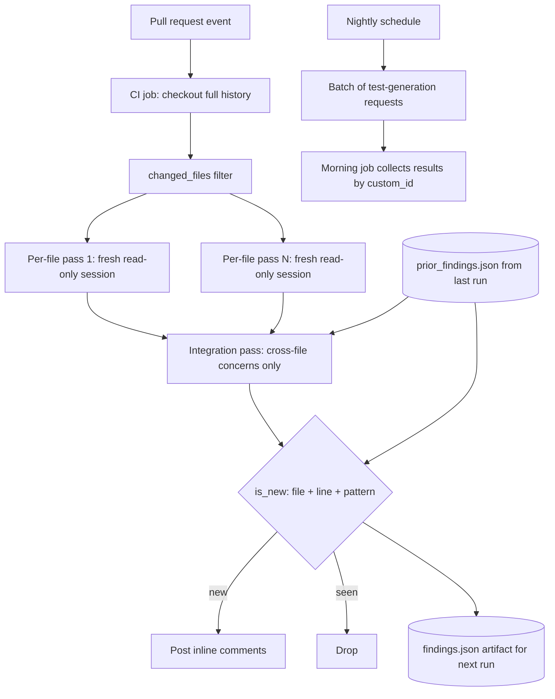

# Scenario 5: Claude Code for Continuous Integration

## Description

You are integrating Claude Code into your Continuous Integration/Continuous Deployment (CI/CD) pipeline. The system runs automated code reviews, generates test cases, and provides feedback on pull requests. You need to design prompts that provide actionable feedback and minimize false positives.

## Primary domains

- [Domain 3: Claude Code Configuration & Workflows](../../domains/03-claude-code-configuration-workflows/README.md)
- [Domain 4: Prompt Engineering & Structured Output](../../domains/04-prompt-engineering-structured-output/README.md)

## Sample questions

### Question 10

Your pipeline script runs `claude "Analyze this pull request for security issues"` but the job hangs indefinitely. Logs indicate Claude Code is waiting for interactive input. What's the correct approach to run Claude Code in an automated pipeline?

- A. Add the `-p` flag: `claude -p "Analyze this pull request for security issues"`
- B. Set the environment variable `CLAUDE_HEADLESS=true` before running the command
- C. Redirect stdin from `/dev/null`: `claude "Analyze this pull request for security issues" < /dev/null`
- D. Add the `--batch` flag: `claude --batch "Analyze this pull request for security issues"`

**Correct: A.** `-p` (or `--print`) is the documented way to run Claude Code non-interactively: it processes the prompt, outputs to stdout, and exits. The other options reference non-existent features (`CLAUDE_HEADLESS`, `--batch`) or Unix workarounds that don't address Claude Code's command syntax.

Related: [3.6](../../domains/03-claude-code-configuration-workflows/3.6-ci-cd-integration.md)

### Question 11

Your team wants to reduce API costs for automated analysis. Currently, real-time Claude calls power two workflows: (1) a blocking pre-merge check that must complete before developers can merge, and (2) a technical debt report generated overnight for review the next morning. Your manager proposes switching both to the Message Batches API for its 50% cost savings. How should you evaluate this proposal?

- A. Use batch processing for the technical debt reports only; keep real-time calls for pre-merge checks.
- B. Switch both workflows to batch processing with status polling to check for completion.
- C. Keep real-time calls for both workflows to avoid batch result ordering issues.
- D. Switch both to batch processing with a timeout fallback to real-time if batches take too long.

**Correct: A.** The Batches API offers 50% savings but up to 24-hour processing with no guaranteed latency SLA, so it is unsuitable for blocking pre-merge checks but ideal for overnight jobs. B is wrong because relying on "often faster" completion isn't acceptable for blocking workflows. C reflects a misconception; results can be correlated with `custom_id`. D adds unnecessary complexity.

Related: [4.5](../../domains/04-prompt-engineering-structured-output/4.5-batch-processing.md)

### Question 12

A pull request modifies 14 files across the stock tracking module. Your single-pass review analyzing all files together produces inconsistent results: detailed feedback for some files but superficial comments for others, obvious bugs missed, and contradictory feedback (flagging a pattern as problematic in one file while approving identical code elsewhere in the same PR). How should you restructure the review?

- A. Split into focused passes: analyze each file individually for local issues, then run a separate integration-focused pass examining cross-file data flow.
- B. Require developers to split large PRs into smaller submissions of 3-4 files before the automated review runs.
- C. Switch to a higher-tier model with a larger context window to give all 14 files adequate attention in one pass.
- D. Run three independent review passes on the full PR and only flag issues that appear in at least two of the three runs.

**Correct: A.** Focused passes address the root cause: attention dilution. Per-file analysis ensures consistent depth; a separate integration pass catches cross-file issues. B shifts burden to developers without improving the system. C misunderstands that larger context windows don't solve attention quality. D would suppress real bugs by requiring consensus on issues that may only be caught intermittently.

Related: [4.6](../../domains/04-prompt-engineering-structured-output/4.6-multi-pass-review.md), [1.6](../../domains/01-agentic-architecture-orchestration/1.6-task-decomposition.md)

## Code snippets

A CI review pipeline plus a nightly batch job, from [3.6](../../domains/03-claude-code-configuration-workflows/3.6-ci-cd-integration.md), [4.1](../../domains/04-prompt-engineering-structured-output/4.1-explicit-criteria.md), [4.5](../../domains/04-prompt-engineering-structured-output/4.5-batch-processing.md) and [4.6](../../domains/04-prompt-engineering-structured-output/4.6-multi-pass-review.md).

The `claude -p`, `--output-format json`, `--json-schema` and `--allowedTools` usage is from the [headless docs](https://code.claude.com/docs/en/headless.md). The GitHub Actions workflow and the `gh api` calls are standard GitHub tooling and are not from the Claude docs; check them against your setup.

### `CLAUDE.md` (project context for the CI run)

```markdown
# Review criteria
Report: bugs (logic errors, unhandled error paths, off-by-one, null dereference) and security issues
(injection, missing authorization, secrets in code, unsafe deserialization).
Skip: formatting, naming style, comment wording, changes that match the surrounding file's local pattern.

Severity: critical = exploitable or data-destroying in production; high = wrong behaviour on a common path;
medium = wrong behaviour on an uncommon path; low = correct but fragile.

<example>
code: db.execute(f"SELECT * FROM users WHERE id = {user_id}")
finding: severity critical, detected_pattern sql_string_interpolation, fix: use a parameterised query
</example>
<example>
code: try: cache.invalidate(key)\nexcept CacheUnavailable: pass  # best-effort, DB is source of truth
finding: none (deliberate and documented; do not flag)
</example>

# Testing standards
Framework pytest; fixtures in tests/conftest.py (db_session, fake_clock, api_client).
A valuable test checks behaviour or an edge case. Skip trivial getters and scenarios already covered.
```

### `ci/review_schema.json`

```json
{
  "type": "object",
  "properties": {
    "findings": {
      "type": "array",
      "items": {
        "type": "object",
        "properties": {
          "file": {"type": "string"},
          "line": {"type": "integer"},
          "severity": {"enum": ["critical", "high", "medium", "low"]},
          "issue": {"type": "string"},
          "suggested_fix": {"type": "string"},
          "detected_pattern": {"type": "string"}
        },
        "required": ["file", "line", "severity", "issue", "detected_pattern"]
      }
    }
  },
  "required": ["findings"]
}
```

### `ci/review.py`: per-file passes, then one integration pass (Q10 and Q12)

```python
import concurrent.futures as cf
import json
import os
import subprocess
from pathlib import Path

SCHEMA = Path("ci/review_schema.json").read_text()
PRIOR = json.loads(Path("prior_findings.json").read_text()) if Path("prior_findings.json").exists() else []


def claude(prompt: str) -> list[dict]:
    """A fresh, non-interactive session: -p prevents the hang, and no --resume means no generator context."""
    run = subprocess.run(
        ["claude", "-p", prompt, "--output-format", "json", "--json-schema", SCHEMA,
         "--allowedTools", "Read,Grep,Glob", "--permission-mode", "dontAsk"],   # read-only: the reviewer can comment, never change the code it reviews
        capture_output=True, text=True, check=True, timeout=900,    # a hung call must fail the job rather than hold the runner
    )
    data = json.loads(run.stdout)
    if "structured_output" not in data:               # absent when no valid structured output was produced
        raise RuntimeError(f"no structured output: {data.get('result', '')[:200]}")   # fail loudly: an empty review would read as a clean PR
    return data["structured_output"]["findings"]


def changed_files() -> list[str]:
    out = subprocess.run(["git", "diff", "--name-only", "origin/main...HEAD"], capture_output=True, text=True, check=True)
    return [f for f in out.stdout.split() if f.endswith((".py", ".ts", ".tsx"))]


def diff_for(path: str) -> str:
    return subprocess.run(["git", "diff", "origin/main...HEAD", "--", path], capture_output=True, text=True, check=True).stdout


def prior_block() -> str:
    return f"<prior_findings>\n{json.dumps(PRIOR)}\n</prior_findings>\nReport only NEW issues or ones still unaddressed." if PRIOR else ""


def review_file(path: str) -> list[dict]:
    return claude(f"Review ONLY this file's changes for local issues, per the criteria in CLAUDE.md.\n"
                  f"File: {path}\n<diff>\n{diff_for(path)}\n</diff>\n{prior_block()}")


def integration_pass(per_file: list[dict]) -> list[dict]:
    return claude("Per-file findings are below. Examine ONLY cross-file concerns in this PR: data flow between files, "
                  "inconsistent handling of the same pattern, contract mismatches. Do not repeat the findings below.\n"
                  f"<per_file_findings>\n{json.dumps(per_file)}\n</per_file_findings>\n{prior_block()}")


def is_new(f: dict) -> bool:   # location + pattern identity, so a re-run after a push does not re-post the same comments
    return not any(p["file"] == f["file"] and p["line"] == f["line"] and p["detected_pattern"] == f["detected_pattern"] for p in PRIOR)


def post(finding: dict) -> None:
    body = f"**{finding['severity'].upper()}**: {finding['issue']}\n\n{finding.get('suggested_fix', '')}"
    subprocess.run(
        ["gh", "api", f"repos/{os.environ['GITHUB_REPOSITORY']}/pulls/{os.environ['PR_NUMBER']}/comments",
         "-f", f"body={body}", "-f", f"commit_id={os.environ['HEAD_SHA']}",
         "-f", f"path={finding['file']}", "-F", f"line={finding['line']}", "-f", "side=RIGHT"],
        check=True,
    )


if __name__ == "__main__":
    files = changed_files()
    with cf.ThreadPoolExecutor(max_workers=4) as pool:   # per-file passes are independent, so they can run in parallel
        per_file = [f for result in pool.map(review_file, files) for f in result]   # same depth for every file
    all_findings = [f for f in per_file + integration_pass(per_file) if is_new(f)]
    Path("findings.json").write_text(json.dumps(PRIOR + all_findings, indent=2))    # next run's prior_findings.json
    if not os.environ.get("DRY_RUN"):   # lets the criteria be tuned against real PRs without posting comments
        for finding in all_findings:
            post(finding)
    print(f"{len(all_findings)} new findings")
```

### `.github/workflows/claude-review.yml`

```yaml
name: claude-review
on: pull_request

permissions:   # least privilege: read the code, write PR comments, nothing else
  contents: read
  pull-requests: write

jobs:
  review:
    runs-on: ubuntu-latest
    steps:
      - uses: actions/checkout@v4
        with: { fetch-depth: 0 }                      # full history, so the origin/main...HEAD diff resolves
      - uses: actions/setup-node@v4
        with: { node-version: 20 }
      - run: npm install -g @anthropic-ai/claude-code
      - uses: actions/download-artifact@v4          # findings.json from the previous run, if any
        continue-on-error: true
        with: { name: findings }
      - run: if [ -f findings.json ]; then mv findings.json prior_findings.json; fi
      - run: python ci/review.py
        env:
          ANTHROPIC_API_KEY: ${{ secrets.ANTHROPIC_API_KEY }}
          GH_TOKEN: ${{ github.token }}
          PR_NUMBER: ${{ github.event.pull_request.number }}
          HEAD_SHA: ${{ github.event.pull_request.head.sha }}
      - uses: actions/upload-artifact@v4
        with: { name: findings, path: findings.json }
```

The pre-merge check blocks developers, so it uses `claude -p` synchronously. Do not move it to the Batches API (Q11).

### `ci/nightly_tests.py`: latency-tolerant work goes to the Batches API

```python
import anthropic
from pathlib import Path
from anthropic.types.message_create_params import MessageCreateParamsNonStreaming
from anthropic.types.messages.batch_create_params import Request

client = anthropic.Anthropic()
MODEL = "claude-sonnet-5-5"
STANDARDS = Path("CLAUDE.md").read_text()


def request_for(module: Path) -> Request:
    existing = Path("tests", f"test_{module.stem}.py")
    existing_src = existing.read_text() if existing.exists() else "(none)"
    return Request(
        custom_id=f"tests-{module.stem}",                 # correlate results by id, order is not guaranteed
        params=MessageCreateParamsNonStreaming(
            model=MODEL, max_tokens=4096,
            system=STANDARDS,
            messages=[{"role": "user", "content": (
                f"Generate pytest tests for this module. Existing tests are below; do not repeat covered scenarios.\n"
                f"<module>\n{module.read_text()}\n</module>\n<existing_tests>\n{existing_src}\n</existing_tests>")}],
        ),
    )


batch = client.messages.batches.create(requests=[request_for(m) for m in Path("src").rglob("*.py")])
Path("nightly_batch_id.txt").write_text(batch.id)       # a morning job streams results by custom_id; see 4.5 for failure handling
```

### Mapping to the sample questions

| Question | Answer in code |
| - | - |
| Q10: job hangs | `claude -p` in `claude()` |
| Q11: batch for both workflows? | pre-merge uses the synchronous CLI; only the nightly job uses batches |
| Q12: 14-file PR | `review_file` per file, then `integration_pass` |

## Commentary: the architecture behind the code

SDK, CLI and config names are illustrative; the exam tests the reasoning, not the exact parameter.

### How the pieces fit together

A CI reviewer is a service that other people's work waits on, so the design priorities differ from interactive use: it must never block on a prompt, its output must be machine-readable, its depth must be consistent across files, and it must not repeat itself on every push. The pipeline is a sequence of narrow stages with deterministic glue between them. Code selects the files, runs one fresh read-only model session per file, hands the findings to one integration pass, deduplicates against earlier runs and posts comments. The model contributes judgement inside each stage; control flow, identity of findings, permissions and cost routing stay in code and configuration. Work that nobody waits for (nightly test generation) leaves this synchronous path and goes to the batch interface for the cost saving.



### Extended walk-through

A pull request changes 14 files in the stock tracking module.

1. **Trigger.** The workflow checks out full history so the three-dot diff against the main branch resolves, and downloads the previous run's findings artifact. On the first run that download fails and the step is allowed to; the prior list is simply empty.
2. **File selection (deterministic).** Code lists changed files and filters to source types. The model is never asked which files to look at.
3. **Per-file passes.** Each file gets a fresh non-interactive session with the same instructions, so depth is uniform. `-p` is what prevents the interactive hang (Q10). Criteria come from `CLAUDE.md`: explicit categories to report, explicit categories to skip, severity definitions and a worked example of deliberate, documented behaviour that must not be flagged. Output is constrained by a JSON schema, so the next stage consumes fields rather than parsing prose.
4. **Integration pass.** A separate session receives the findings, not all the code, and looks only for cross-file concerns: data flow between modules, the same pattern handled differently in two files, mismatched contracts. This is where the contradiction from the sample question (flagged in one file, approved in another) is caught and reconciled.
5. **Deduplication (deterministic).** Findings are keyed by file, line and detected pattern and compared against the prior run. Only new or unaddressed items are posted, so developers are not re-notified about issues they have seen.
6. **Posting.** The findings file is written before comments are posted, so a failure in the posting step does not lose the review.
7. **Next push.** The developer fixes two issues. The rerun passes the prior findings into each prompt and into the dedupe step, so the output is only what is new or still open.

Failure paths:

- **No structured output.** The wrapper raises instead of returning an empty list. A silent empty result would look like a clean PR; a failed job is visible and retryable.
- **Hang or runaway call.** A timeout fails the job rather than occupying the runner indefinitely.
- **False-positive complaints.** Developers start ignoring comments. The fix is sharper criteria, explicit skip categories and examples that show the boundary; temporarily switching off a noisy category preserves trust while it is refined. Telling the model to be "conservative" does not change what it considers a finding.
- **Very large single-file diff.** One file can still exceed what a single pass handles well; the same decomposition principle applies, splitting by region before the integration pass.
- **Nightly batch partial failure.** Some requests fail: oversized inputs are chunked and resubmitted, transient failures are resubmitted as they are, and only the failed ids are retried (4.5).

### Design decisions and trade-offs

- **Synchronous for the merge gate, batch for the nightly job (Q11).** Batches save about half the cost but have no latency guarantee; a blocking check cannot depend on that. A timeout fallback to synchronous adds a second path and still depends on the first. If nobody is waiting, batch wins on cost, and results are matched by `custom_id`, not by order.
- **Per-file plus integration passes (Q12).** The inconsistency is attention dilution, so the fix reduces what each pass must hold. Extra calls cost more than a single pass but can run in parallel. A single pass is acceptable for small PRs; asking developers to split PRs only moves the work, and majority voting across full-PR runs suppresses bugs that are found intermittently.
- **Explicit criteria and a "do not flag" example.** Precision comes from defining what counts, not from asking for caution. Fewer comments is a goal only if the remaining ones are right; the worked examples encode the boundary between a bug and a deliberate pattern.
- **Schema-constrained output with a pattern field.** The schema guarantees structure, not correctness; a finding can still be wrong. The `detected_pattern` field makes deduplication and false-positive analysis possible by grouping findings by cause.
- **Fresh, read-only sessions.** The reviewer sees the diff, not the author's reasoning, and has no write tools. If the same session that wrote the code reviewed it, it would carry the reasoning that produced the defects; an independent instance is the stronger check. The price is that review has no knowledge of intent unless the PR description supplies it.
- **Prior findings in both prompt and code.** The prompt reduces re-reporting; the code guarantees it. Relying on either alone is weaker, and the code check is the one that must always hold.

### Exam traps in this scenario

- **Q10, B (`CLAUDE_HEADLESS=true`) and D (`--batch`):** invented switches. Rule: use the documented non-interactive mechanism; distrust options that sound plausible but name features you cannot place.
- **Q10, C (redirect stdin from `/dev/null`):** a Unix workaround that ignores the tool's own mode for non-interactive runs. Rule: solve the problem with the tool's supported option, not by tricking the environment.
- **Q11, B (batch both with polling):** a blocking gate on a service with no latency guarantee. Rule: batch for non-blocking work only.
- **Q11, C (keep both real-time to avoid ordering issues):** ordering is a non-problem because results are correlated by id. Rule: verify the premise before rejecting a cost saving.
- **Q11, D (batch both with a real-time fallback):** extra complexity that does not address the diagnosis. Rule: do not add infrastructure that does not fix the stated cause.
- **Q12, B (smaller PRs):** shifts burden to developers. Rule: fix the system, not the user.
- **Q12, C (larger model or window):** capacity is not the problem; attention across many items is. Rule: decompose before scaling.
- **Q12, D (consensus across three runs):** discards real but intermittently found bugs and triples cost. Rule: consensus filtering lowers recall and does not make a pass more consistent.
- Likely further distractors: "report only high-confidence findings" (self-reported confidence is uncalibrated); having the reviewer apply fixes and push (least privilege: reviewers read, humans or separate jobs write); reusing the generating session for review; posting prose and regex-parsing it instead of a schema; a single prompt covering per-file and cross-file concerns. Rule: one objective per pass, structured interfaces between stages.

### Check yourself

- **The review job hangs forever in CI. Name the cause and the right fix.** The CLI is waiting for interactive input; run it in its documented non-interactive mode so it processes the prompt, prints and exits.
- **Why is the nightly test-generation job in a batch and the pre-merge review not?** Both are model calls; the difference is who waits. Nobody blocks on the overnight job, so the cost saving is free. The merge gate needs a bounded response time that the batch interface does not promise.
- **A 14-file PR gets deep comments on some files and shallow ones on others, plus contradictions. Why does a bigger context window not fix it?** The failure is uneven attention, not capacity. Per-file passes give each file the same focus, and an integration pass over findings handles what only shows up across files.
- **Developers say the bot is noisy and ignore it. What do you change first?** The criteria: define what to report and what to skip, add examples of deliberate patterns that must not be flagged, and dedupe repeat comments. Collecting findings by `detected_pattern` shows which category to refine or pause.
