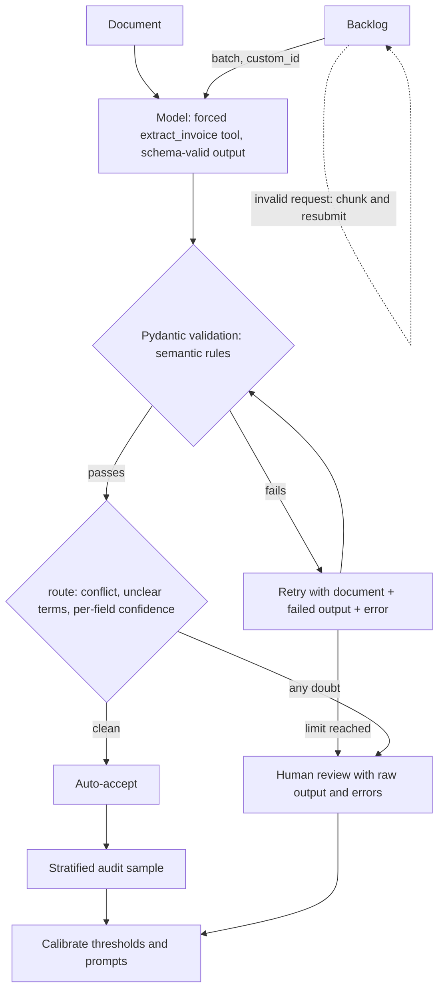

# Scenario 6: Structured Data Extraction

## Description

You are building a structured data extraction system using Claude. The system extracts information from unstructured documents, validates the output using JavaScript Object Notation (JSON) schemas, and maintains high accuracy. It must handle edge cases gracefully and integrate with downstream systems.

## Primary domains

- [Domain 4: Prompt Engineering & Structured Output](../../domains/04-prompt-engineering-structured-output/README.md)
- [Domain 5: Context Management & Reliability](../../domains/05-context-management-reliability/README.md)

## Sample questions

_None provided in the exam guide for this scenario._

## Code snippets

A full extraction pipeline from [4.2](../../domains/04-prompt-engineering-structured-output/4.2-few-shot-prompting.md) to [4.5](../../domains/04-prompt-engineering-structured-output/4.5-batch-processing.md) and [5.5](../../domains/05-context-management-reliability/5.5-human-review-confidence.md): schema, few-shot, forced tool call, validation with retry, batch processing, and review routing.

### `extract.py`

```python
import json
import random
import time
from typing import Literal

import anthropic
from anthropic.types.message_create_params import MessageCreateParamsNonStreaming
from anthropic.types.messages.batch_create_params import Request
from pydantic import BaseModel, ValidationError, model_validator

client = anthropic.Anthropic()
MODEL = "claude-sonnet-5-5"     # forced tool_choice is rejected on some newer models; see 2.3 and 4.3 for the alternatives

# ---------- 1. schema: optional/nullable fields, enum with unclear/other, self-check fields ----------
EXTRACT_INVOICE = {
    "name": "extract_invoice",
    "description": "Record the structured fields extracted from an invoice. Use null for anything not in the document.",
    "input_schema": {
        "type": "object",
        "properties": {
            "invoice_number": {"type": "string"},
            "vendor": {"type": ["string", "null"]},
            "stated_total": {"type": ["number", "null"], "description": "Total printed on the document"},
            "calculated_total": {"type": ["number", "null"], "description": "Sum of line items you computed"},
            "currency": {"type": ["string", "null"], "description": "ISO 4217, e.g. USD"},
            "payment_terms": {"type": "string", "enum": ["net_30", "net_60", "due_on_receipt", "unclear", "other"]},
            "payment_terms_detail": {"type": ["string", "null"], "description": "Required when payment_terms is 'other'"},
            "conflict_detected": {"type": "boolean", "description": "True if the document contradicts itself"},
            "line_items": {"type": "array", "items": {"type": "object", "properties": {
                "description": {"type": "string"}, "quantity": {"type": "number"}, "unit_price": {"type": "number"}},
                "required": ["description", "quantity", "unit_price"]}},
            "confidence": {"type": "object", "description": "0-1 confidence per field",
                           "properties": {"invoice_number": {"type": "number"}, "vendor": {"type": "number"},
                                          "stated_total": {"type": "number"}, "payment_terms": {"type": "number"}}},
        },
        "required": ["invoice_number", "payment_terms", "line_items", "conflict_detected"],
    },
}

SYSTEM = """Extract invoice data using the extract_invoice tool.
Normalise: dates to ISO 8601, amounts to plain numbers without currency symbols ("$1,200.50" -> 1200.5).
If a field is not present in the document return null. Never guess or fabricate.

<example>
doc: "Inv 77, Acme Ltd. 2 x widget @ $150. Total due $300. Terms: 45 days."
out: invoice_number "77", vendor "Acme Ltd", stated_total 300, calculated_total 300,
     payment_terms "other", payment_terms_detail "45 days", currency "USD"
</example>
<example>
doc: "Invoice 78. Consulting, 10 hrs."   (no prices, no total, no terms)
out: stated_total null, calculated_total null, payment_terms "unclear", line_items unit_price 0 ... flag low confidence
</example>"""

TOOL_CHOICE = {"type": "tool", "name": "extract_invoice"}   # forcing the tool guarantees well-formed output, not correct values


# ---------- 2. semantic validation (syntax is already guaranteed by tool use) ----------
class LineItem(BaseModel):
    description: str
    quantity: float
    unit_price: float


class Invoice(BaseModel):
    invoice_number: str
    vendor: str | None = None
    stated_total: float | None = None
    calculated_total: float | None = None
    currency: str | None = None
    payment_terms: Literal["net_30", "net_60", "due_on_receipt", "unclear", "other"]
    payment_terms_detail: str | None = None
    conflict_detected: bool = False
    line_items: list[LineItem]
    confidence: dict[str, float] = {}

    @model_validator(mode="after")
    def checks(self):   # cross-field rules the JSON schema cannot express, so they run in code
        if self.payment_terms == "other" and not self.payment_terms_detail:
            raise ValueError("payment_terms is 'other' but payment_terms_detail is empty")
        if self.stated_total is not None and self.calculated_total is not None \
                and abs(self.stated_total - self.calculated_total) > 0.01:   # tolerance absorbs rounding, not real mismatches
            raise ValueError(f"stated_total {self.stated_total} != calculated_total {self.calculated_total}")
        return self


# ---------- 3. synchronous extraction with retry-with-error-feedback ----------
def call_model(messages: list[dict]) -> dict:
    r = client.messages.create(model=MODEL, max_tokens=2048, system=SYSTEM, tools=[EXTRACT_INVOICE],
                               tool_choice=TOOL_CHOICE, messages=messages)
    return next(b.input for b in r.content if b.type == "tool_use")


def extract_with_retry(document: str, max_retries: int = 2) -> dict:
    messages = [{"role": "user", "content": f"<document>\n{document}\n</document>"}]
    for attempt in range(max_retries + 1):
        raw = call_model(messages)
        try:
            return {"status": "ok", "invoice": Invoice.model_validate(raw)}
        except ValidationError as e:
            if attempt == max_retries:
                return {"status": "needs_review", "raw": raw, "errors": e.errors()}
            # retry carries the document, the failed extraction and the specific error.
            # It only helps when the answer is in the document; absent fields should be null, not retried.
            messages += [
                {"role": "assistant", "content": json.dumps(raw)},
                {"role": "user", "content": f"Validation failed:\n{e}\nRe-read the document and correct only the "
                                            "failing fields. If the information is not in the document, use null."},
            ]


# ---------- 4. batch processing for the backlog ----------
def batch_request(doc_id: str, text: str) -> Request:
    return Request(
        custom_id=f"doc-{doc_id}",
        params=MessageCreateParamsNonStreaming(
            model=MODEL, max_tokens=2048, system=SYSTEM, tools=[EXTRACT_INVOICE], tool_choice=TOOL_CHOICE,
            messages=[{"role": "user", "content": f"<document>\n{text}\n</document>"}],
        ),
    )


def run_batch(docs: dict[str, str]) -> dict[str, dict]:
    batch = client.messages.batches.create(requests=[batch_request(i, t) for i, t in docs.items()])
    while (batch := client.messages.batches.retrieve(batch.id)).processing_status != "ended":
        time.sleep(60)   # polling is acceptable because nothing blocks on this job

    results, resubmit = {}, {}
    for r in client.messages.batches.results(batch.id):
        doc_id = r.custom_id.removeprefix("doc-")
        out = r.result
        if out.type == "succeeded":
            raw = next(b.input for b in out.message.content if b.type == "tool_use")
            try:
                results[doc_id] = {"status": "ok", "invoice": Invoice.model_validate(raw)}
            except ValidationError:
                results[doc_id] = extract_with_retry(docs[doc_id])         # semantic failure: sync retry with feedback
        elif out.type == "errored" and out.error.error.type == "invalid_request_error":
            resubmit[doc_id] = docs[doc_id][: len(docs[doc_id]) // 2]       # e.g. too large: chunk, then resubmit
        else:                                                               # server error, expired, canceled
            resubmit[doc_id] = docs[doc_id]
    if resubmit:
        results.update(run_batch(resubmit))       # only the failed custom_ids go back in
    return results

# SLA: a 30h guarantee with 24h batch processing needs a submission window of at most 6h (4h leaves margin).
# Tune SYSTEM/schema on ~20 sample documents synchronously BEFORE submitting a large batch.


# ---------- 5. confidence routing and ongoing audit ----------
THRESHOLDS = {"invoice_number": 0.90, "vendor": 0.85, "stated_total": 0.95, "payment_terms": 0.90}   # calibrate per field on labelled data


def route(result: dict) -> str:
    if result["status"] != "ok":   # retries exhausted: an unvalidated extraction is never auto-accepted
        return "human_review"
    inv: Invoice = result["invoice"]
    if inv.conflict_detected or inv.payment_terms == "unclear":
        return "human_review"                                               # ambiguous or contradictory source
    for field_name, floor in THRESHOLDS.items():
        if inv.confidence.get(field_name, 0.0) < floor:   # a missing score counts as low confidence: the safe default
            return "human_review"
    return "auto_accept"


def audit_sample(auto_accepted: list[dict], per_stratum: int = 20) -> list[dict]:
    """Stratified random sample of auto-accepted output by document type, reviewed to catch drift."""
    strata: dict[str, list[dict]] = {}
    for rec in auto_accepted:
        strata.setdefault(rec["doc_type"], []).append(rec)
    return [r for recs in strata.values() for r in random.sample(recs, min(per_stratum, len(recs)))]


if __name__ == "__main__":
    docs = {"1": "Invoice 1001 ... Total $500.00 ...", "2": "Inv 77, Acme Ltd ..."}
    for doc_id, result in run_batch(docs).items():
        print(doc_id, route(result))
```

### Before automating: validate by segment

```python
import pandas as pd

df = pd.read_csv("labelled_validation.csv")        # doc_type, field, correct, confidence
print(df.groupby(["doc_type", "field"]).correct.agg(["mean", "count"]).sort_values("mean").head(10))
```

A 97% overall accuracy can hide a document type or field that fails badly. Check each segment before reducing human review.

### What each piece addresses

| Concern | Where |
| - | - |
| Fabricated values for absent fields | nullable fields, `null` few-shot example, `"unclear"` enum value |
| Syntax errors | tool use with a JSON schema |
| Semantic errors (totals, wrong field) | `Invoice` validators plus `calculated_total` / `stated_total` / `conflict_detected` |
| Retry when it can help | `extract_with_retry` sends document + failed output + error |
| Information absent from source | stays `null`; retrying would not find it |
| Backlog cost | batch with `custom_id`; only failed ids resubmitted, oversize documents chunked |
| Limited reviewer time | `route` sends low-confidence or contradictory documents to humans |
| Drift in auto-accepted output | `audit_sample` stratified sampling |

## Commentary: the architecture behind the code

SDK, CLI and config names are illustrative; the exam tests the reasoning, not the exact parameter.

### How the pieces fit together

The pipeline layers guarantees, each catching a different failure class, so that the model only has to do the part that needs judgement: reading a messy document and filling a schema honestly. The forced tool call and schema remove syntax errors. Nullable fields and the `unclear` and `other` enum values remove the pressure to fabricate. Code validators and the self-check fields (`stated_total`, `calculated_total`, `conflict_detected`) expose semantic errors that a schema cannot express. A bounded retry loop repairs the errors that are repairable. Whatever is still doubtful is routed to people, and the output that was trusted is sampled afterwards to detect drift. No layer is trusted to do another layer's job, and the output of each layer is explicit (a status, an error list, a route), so the system can be measured and tuned.



### Extended walk-through

A backlog of invoices arrives for overnight processing.

1. **Tune before scaling.** About 20 sample documents run synchronously first. Prompt and schema defects are discovered cheaply, before a large batch bakes them into thousands of results.
2. **Submit as a batch.** Every request carries a `custom_id` so results can be matched to documents regardless of completion order. Nothing blocks on this job, so latency does not matter and the cost saving is free.
3. **Extraction.** Each request forces the extraction tool, so the response is always a schema-shaped object and never chatty prose. The prompt contains normalisation rules and examples, one of which shows `null` for absent data and `unclear` for undetermined terms.
4. **Sparse document.** "Invoice 78. Consulting, 10 hrs." has no prices, total or terms. The model returns nulls and `unclear` instead of inventing numbers, because the schema allows it and the example shows it. This is valid output, so no retry is attempted: the information is not in the document and no number of retries would add it.
5. **Routing the sparse document.** `unclear` terms send it to human review. That rule is business policy encoded in code, not model judgement.
6. **Self-contradicting document.** The printed total is 500 and the lines sum to 450. The model reports both figures and sets the conflict flag. The validator raises a semantic error, and the retry loop sends the document, the failed extraction and the specific error back. If the document genuinely says both things, the retries cannot resolve it and the record lands in review with the raw output and error list, so a reviewer sees both numbers. As written, the validator rejects every mismatch, including real source contradictions, so those spend their retries before reaching review; skipping the mismatch error when the conflict flag is set would send genuine contradictions straight to review.
7. **Misread field.** A total transposed by the model is fixed on retry because the correct value exists in the document and the error message names the failing check.
8. **Oversized document.** The batch returns an invalid-request error for it. The document is split and only that id is resubmitted. Server errors or expiry resubmit it unchanged. Resubmitting the whole batch would repay every success.
9. **Confidence routing.** Valid results are compared per field against calibrated thresholds; a missing score counts as low. Conflicts and unclear terms go to humans regardless of confidence, because confidence does not resolve contradictory inputs.
10. **Audit.** A stratified sample of auto-accepted records per document type is reviewed continuously. This catches drift and errors in the high-confidence band that routing alone cannot see.

### Design decisions and trade-offs

- **Forced tool call with a JSON schema.** It eliminates the failure class "malformed output" instead of recovering from it, which parse-and-retry on free text does not. It guarantees syntax only. `auto` could return text; `any` fits when several schemas exist and the document type is unknown. Newer structured-output options give the same guarantee more simply for pure extraction.
- **Nullable fields, `unclear` and `other` enum values.** Required fields force fabrication when a document lacks a value, and a closed enum forces novel cases into wrong buckets. The cost is handling `null` downstream, which is small compared with silently wrong data.
- **Validation in code plus self-check fields.** A schema cannot compare two fields; a validator can. Asking the model to compute `calculated_total` gives the code evidence to compare, and extracting both numbers is better than silently choosing the printed one. Retrying helps only when the answer is in the document; absent information stays `null`.
- **Batch for the backlog, synchronous for exceptions.** Batch halves cost and has no latency guarantee, so it fits an overnight backlog and not a user waiting. Semantic failures are retried synchronously for those documents only. The submission window must leave room for processing time: with a 24-hour processing worst case, a 30-hour commitment needs a submission window of at most 6 hours.
- **Per-field calibrated thresholds and conflict routing.** Fields differ in difficulty, so one global threshold over-accepts hard fields or over-reviews easy ones. Self-reported confidence is only usable after calibration against labelled data. Reviewer capacity is finite, so thresholds are set from the cost of an error, not a round number.
- **Segment-level validation and stratified sampling.** A high overall accuracy can hide one document type or field that fails badly. A random sample over-represents easy types and under-samples rare ones; stratification by type and continued sampling of auto-accepted output expose drift.

### Exam traps in this scenario

The exam guide provides no sample questions for this scenario, so these traps come from task statements 4.1 to 4.5 and 5.5 and the usual distractors for them.

- **"Mark fields required so the output is complete."** Forces fabrication when the source lacks the value. Rule: make fields nullable when the document may not contain them.
- **"Ask for JSON in the prompt and retry on parse errors."** Recovers from a failure class that tool use removes. Rule: choose the mechanism that eliminates the failure, not one that handles it.
- **"Tool use guarantees correct data."** It guarantees syntax. Rule: schema validity is not semantic correctness; validate totals and placement in code.
- **"Retry until validation passes."** Retries cannot create absent information and push the model to guess. Rule: retry only when the information exists in the source, and include the specific error.
- **"Re-run the same prompt without error detail."** The model repeats itself. Rule: feed back document, failed output and the specific failure.
- **"Use a stricter schema to catch the totals mismatch."** A schema cannot compare fields. Rule: cross-field checks belong in code.
- **"Use batch for every document, with a real-time fallback."** The urgent and the non-urgent differ in latency need. Rule: batch for non-blocking work only; calculate the submission window from the processing worst case.
- **"Resubmit the whole batch after failures."** Rule: resubmit only the failed ids, modified when the cause is the request (chunk oversized documents).
- **"97% overall accuracy, so automate."** Aggregates hide failing segments. Rule: validate by document type and field before reducing review.
- **"Auto-accept anything with high confidence, even if the source contradicts itself."** Rule: contradictory or ambiguous sources go to a human; confidence is not evidence of agreement.
- **"Review a random sample."** Rule: stratify, and keep sampling auto-accepted output after launch.
- **"Add 'be careful' to the prompt or use a larger model."** The failure is unspecified rules and examples, not capability. Rule: specific criteria and examples before capacity.

### Check yourself

- **A document omits the vendor name. How should the pipeline treat it, and why is a retry the wrong response?** Return `null` for the vendor. The value is not in the source, so a retry cannot find it and would pressure the model to invent one; missing mandatory data is a routing decision, not an extraction retry.
- **Extraction output always parses against the schema, yet totals are sometimes wrong. Where does the fix belong?** In semantic validation in code that compares stated and calculated totals, with a retry carrying the specific error. Syntactic guarantees do not cover correctness.
- **The overall accuracy on a validation set is 97%. What must you check before cutting human review?** Accuracy per document type and per field, since a single segment can fail badly and be masked by the average. Then set per-field thresholds from labelled data.
- **Why sample documents that were auto-accepted?** Routing only inspects what the system flags. Drift, new document layouts and errors in the high-confidence band are only visible by auditing what passed, stratified so rare types are represented.
